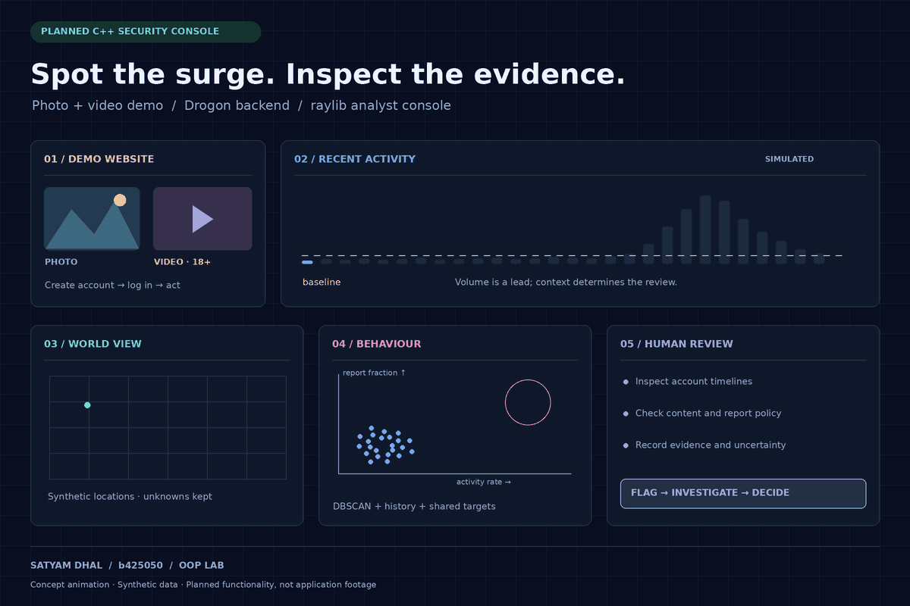
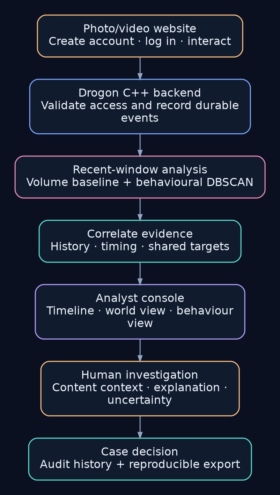
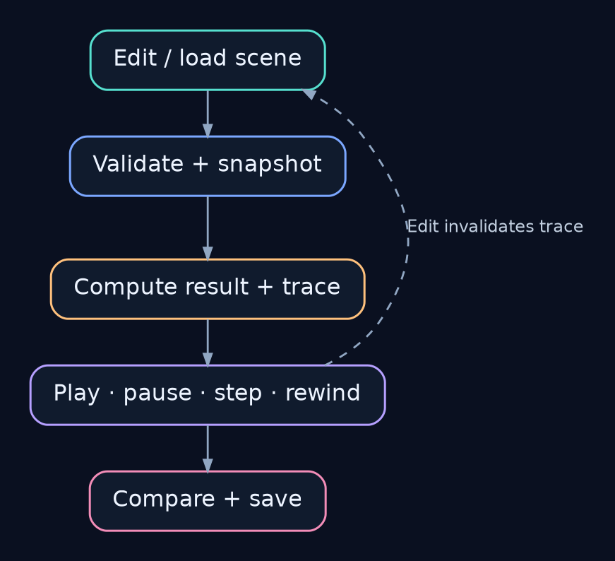
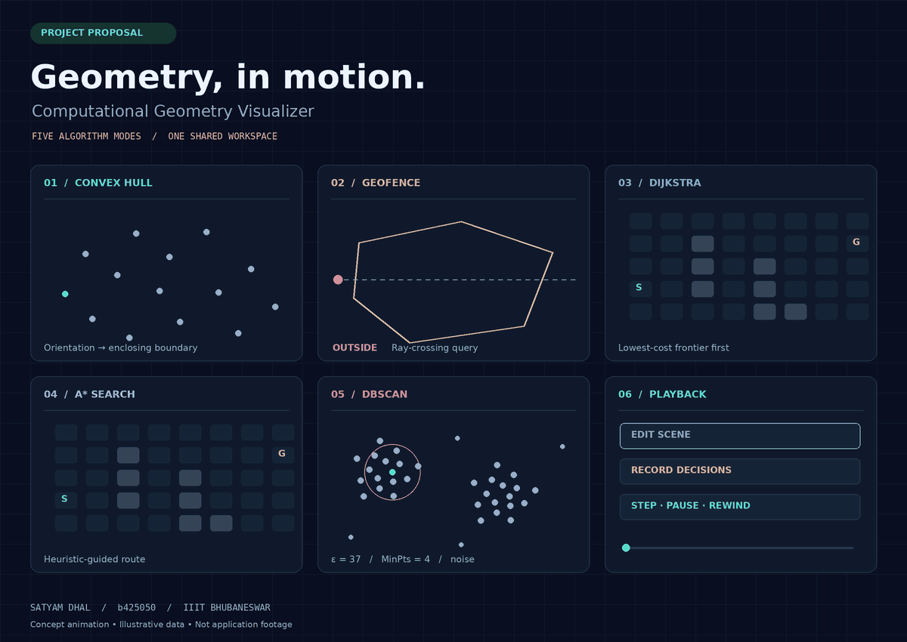

<div align="center">

# Spatial Security Analytics Console

### Spot the surge. Inspect the evidence. Explain the decision.

A C++ investigation console for coordinated reporting and engagement abuse on a photo/video demo website.


[Full project specification](docs/PROJECT_SPECIFICATION.md) · [Console workflow](#from-a-post-to-an-investigation) · [Algorithm Lab](#the-algorithm-lab) · [Submitted proposal](docs/proposal/Computational_Geometry_Visualizer_Submission.pdf)



**Temporary concept asset — replace before submission.** Synthetic data; planned functionality, not application footage.<br>
[View the static overview](dev-notes/media/console-overview.png)

</div>

> **Current status:** Specification and presentation assets only. The website, Drogon service, desktop console, algorithms and tests have not been implemented. The features below define the planned product.

## The project

A sudden rise in reports or dislikes deserves context. Did a video become popular? Are genuine viewers reporting a policy problem? Or are accounts repeatedly targeting the same creators in synchronized bursts?

The console will bring together activity timelines, DBSCAN groups, account histories, geographic context and content review. Analysts will inspect the evidence, record uncertainty, and make a documented decision. A suspicious pattern is an investigation lead; it does not establish that a report is false.

The project has **three connected parts**:

| Part | Planned experience |
| :--- | :--- |
| **Photo/video website** | Register, log in, browse, follow creators, view eligible media, react, comment and report. |
| **Security Console** | Detect surges, explore behavioural and geographic groups, review histories, investigate cases and export evidence. |
| **Algorithm Lab** | Edit scenes and step through the proposal's geometry, graph-search and clustering algorithms. |

## A small social website, a complete event trail

The original, Instagram-inspired demo will include photos, native HTML video playback, creator profiles, chronological feeds, likes/dislikes, comments and categorized reports.

**Login and account creation are required features.** A Drogon C++ backend will manage sessions, roles, validation, persistence and durable activity records. Repeated requests will not create duplicate reactions or reports.

**Age-restricted posts are part of the demo.** General-audience and 18+ labelled sample posts will use benign media. Age access will be enforced by the server across feeds, thumbnails, direct media URLs and APIs. Eligibility will use declared age for demonstration; it will not be presented as verified age assurance.

## From a post to an investigation



[View diagram source](docs/diagrams/console-workflow-overview.mmd)

### What the analyst will inspect

- **Activity timeline:** reports, dislikes, registrations, distinct actors, reference baselines and sudden changes.
- **Behaviour view:** scaled activity/report features, DBSCAN core/border/noise labels and parameter comparisons.
- **World view:** clearly labelled simulated/approximate locations, geographic density, projected hulls and analyst-drawn region queries.
- **Account history:** creation time, previous activity, repeated common targets and synchronized action patterns.
- **Evidence and cases:** linked events, content-policy context, alternative explanations, analyst notes and audited manual decisions.

Geographic and behavioural clustering will be separate analyses with appropriate metrics. The system must handle distributed campaigns, legitimate regional audiences, missing locations and insufficient history.

## C++ throughout

| Layer | Planned technology |
| :--- | :--- |
| Backend and application rules | **C++20 + Drogon** |
| Website presentation | **Server-rendered HTML + CSS**, forms and native media controls |
| Analyst console and Algorithm Lab | **C++ + raylib** |
| Detection, geometry and graph algorithms | Shared **C++** library |
| Local persistence | **SQLite**, protected media storage and database migrations |
| Scenario simulation and tests | **C++** |
| Build and documentation | CMake/CTest, Markdown and Mermaid |

**No JavaScript, TypeScript, Python or Node.js in the delivered application.** Website actions will use server-rendered pages/forms; the desktop console will refresh through an authenticated C++ client. Algorithms will remain independent of rendering and playback timing.

## The Algorithm Lab

The five modes from the submitted proposal remain required. They share scene editing, validated inputs, typed trace events, deterministic replay and operation counters.

| Mode | What it will explain | Product connection |
| :--- | :--- | :--- |
| **Monotone chain convex hull** | Orientation tests, candidate removal and boundary construction. | Summarize an appropriate projected geographic footprint. |
| **Ray-casting / geofence query** | Edge tests and inside/outside/boundary classification. | Explore analyst-selected geographic regions. |
| **Dijkstra** | Frontier distances, edge relaxation and optimal routes. | Routing baseline in the lab's weighted scenes. |
| **A\*** | g/h/f scores and heuristic-guided exploration. | Compare routes with Dijkstra using valid heuristics. |
| **DBSCAN** | Radius queries, expansion queues, core/border/noise transitions. | Explain behavioural and geographic density analyses. |



[View diagram source](docs/diagrams/algorithm-workflow-overview.mmd)

<details>
<summary><strong>View the animated Algorithm Lab concept</strong></summary>



**Temporary concept asset — replace before submission.** Illustrative scenes, not application footage.<br>
[Static alternative](dev-notes/media/geometry-overview.png)

</details>

### Extensions with a defined purpose

The [algorithm catalogue](docs/PROJECT_SPECIFICATION.md#9-algorithm-catalogue) lists required techniques and scoped enhancements: closest pair, k-d trees, spatial grids, indexed and spatiotemporal DBSCAN, EWMA/change detection, graph exploration, alternative hulls, clipping, triangulation, similarity measures and review-budget optimization.

Each addition must have a useful role, stated assumptions and correctness checks. Routing remains a meaningful lab demonstration; shortest paths between accounts will not be presented as proof of coordination. Selecting whole cases under a review budget is an optional **integer linear programming** extension.

## A demonstration that tests the explanation

The C++ simulator will produce repeatable scenarios with separate ground-truth labels:

| Scenario | What it tests |
| :--- | :--- |
| Normal activity | Baselines and unsupported-alert avoidance. |
| Legitimate viral surge | Increased volume without automatically assuming abuse. |
| Genuine mass reporting | Reports can be valid even when many users act together. |
| Newly created reporting cohort | Creation bursts, synchronization and repeated targets. |
| Geographically distributed campaign | Behavioural evidence without geographic concentration. |
| Older accounts, sparse data and mixed cohorts | Limits of age, density and historical evidence. |
| Age access, retries and restart | Permissions, counting integrity and durable recovery. |

Manual account creation/reporting will demonstrate the complete website-to-console path. Larger seeded cohorts will support controlled comparisons. Evaluations will record false positives, precision/recall, detection delay and parameter sensitivity, with limitations published alongside results.

## Implementation roadmap

1. **Foundation:** C++ build, Drogon service, SQLite and shared domain types.
2. **Website:** authentication, profiles, media, age access and interactions.
3. **Event pipeline:** durable records and reproducible C++ scenarios.
4. **Analysis:** baselines, feature extraction, DBSCAN and evidence explanations.
5. **Console:** linked views, cases, manual review and exports.
6. **Algorithm Lab:** all five proposal modes and shared playback.
7. **Completion:** security/correctness checks, measured validation, documentation and real feature GIFs.
8. **Enhancements:** selected catalogue additions after the required workflow works.

See the [complete specification and required-feature checklist](docs/PROJECT_SPECIFICATION.md) for scope. The documentation below explains how to implement it; build commands remain proposed until the source/build system exists.

## Documentation

| Document | Purpose |
| :--- | :--- |
| [Documentation handbook](docs/README.md) | Product, engineering and academic reference index. |
| [Architecture](docs/implementation/ARCHITECTURE.md) | System boundaries, ownership and engineering decisions. |
| [API reference](docs/implementation/API_REFERENCE.md) | HTTP/authentication contracts and endpoint behaviour. |
| [Algorithm explanations](docs/algorithms/CORE_ALGORITHMS.md) | Worked examples, assumptions and complexity. |
| [User guide](docs/user/USER_GUIDE.md) | Website, analyst and Algorithm Lab operation. |
| [Academic report](docs/academic/PROJECT_REPORT.md) | Report narrative with implementation evidence explicitly pending. |
| [Demonstration guide](docs/user/DEMONSTRATION.md) | Product and algorithm demonstration runbook. |
| [Submission checklist](docs/SUBMISSION_CHECKLIST.md) | Final documentation, cleanup and release checks. |

The reference documentation describes the planned system. Actual measurements, screenshots and test outcomes belong in the [validation record](docs/testing/VALIDATION_RECORD.md).

<!-- BEGIN TEMPORARY DEVELOPMENT LINKS -->
**Development only:** the [temporary preparation hub](dev-notes/README.md) holds personal tutorials, viva notes and concept artwork. It is marked for removal when the author explicitly requests final cleanup.
<!-- END TEMPORARY DEVELOPMENT LINKS -->

## Repository guide

```text
README.md                         Project overview
docs/
  README.md                       Documentation handbook and navigation
  CONTRACTS.md                    Shared technical definitions
  PROJECT_SPECIFICATION.md        Complete product and implementation plan
  requirements/                   Software requirements
  implementation/                 Retained engineering reference
  algorithms/                     Foundations, examples and extensions
  testing/                        Test matrix and validation evidence
  evaluation/                     Scenarios and measurement methodology
  user/                           User and demonstration guides
  academic/                       Project report draft
  diagrams/                       Editable workflow diagram sources
  proposal/                       Original submitted proposal PDF
  media/                          Retained workflow and final product media
dev-notes/                        TEMPORARY: remove on final cleanup request
```

[Browse the documentation handbook](docs/README.md) for the complete reading path. Application folders will be introduced with their implementations.

## Academic details

| | |
| :--- | :--- |
| **Student** | Satyam Dhal |
| **Student ID** | b425050 |
| **Branch** | Computer Science and Engineering |
| **College** | International Institute Of Information Technology, Bhubaneswar |
| **Subject** | OOP LAB |
| **Course Faculty** | Dr. Srichandan Shobhanayak |

---

<div align="center">

**Spatial Security Analytics Console**<br>
An OOP LAB project by **Satyam Dhal** · **b425050**

[Project specification](docs/PROJECT_SPECIFICATION.md) · [Original proposal](docs/proposal/Computational_Geometry_Visualizer_Submission.pdf)

</div>
