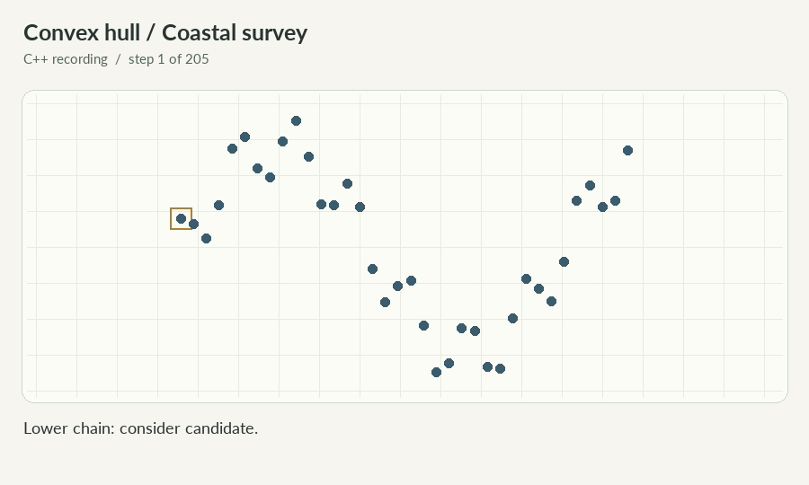
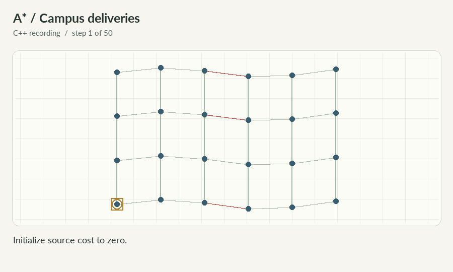
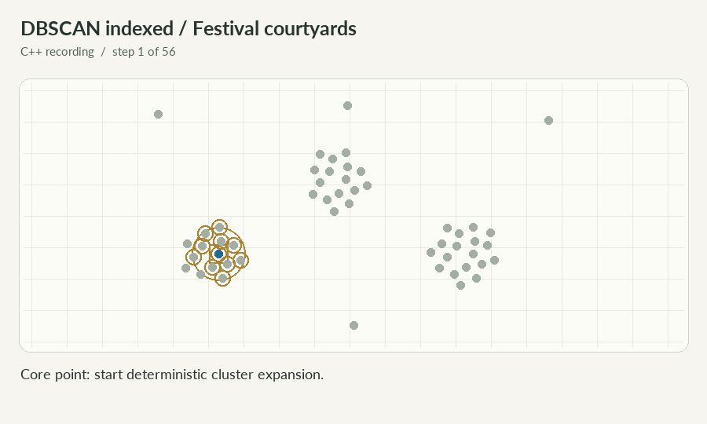
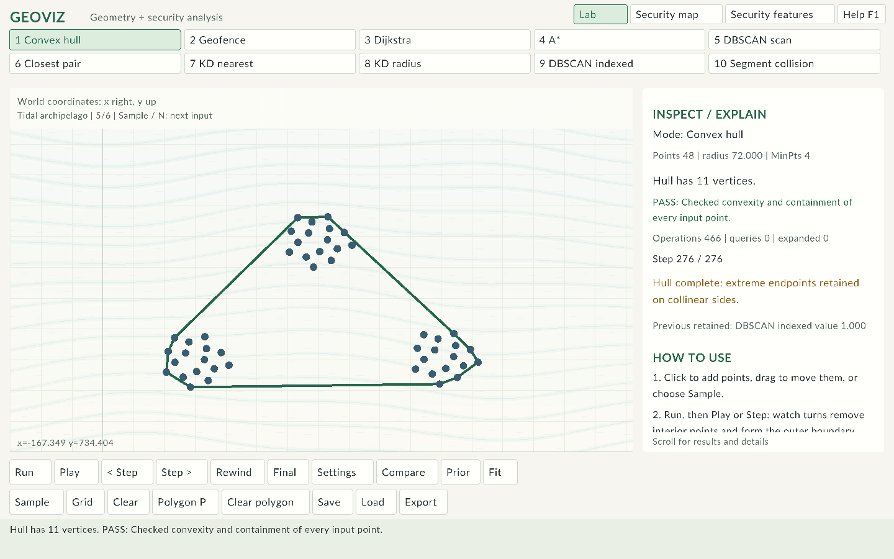
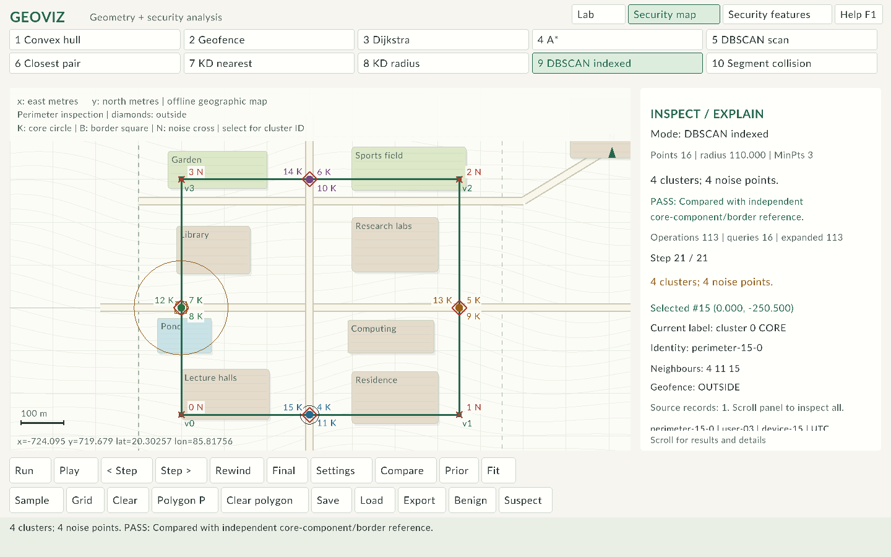
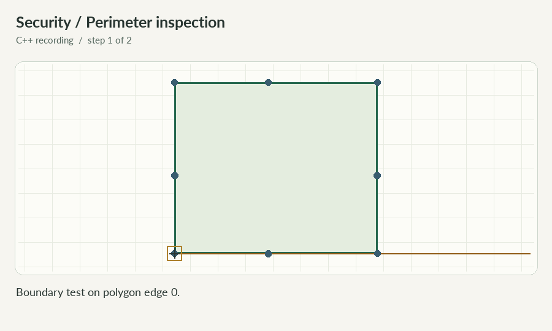

# GeoViz

**Computational Geometry Visualizer and Spatial Security Console**

C++17 Object-Oriented Programming project by **Satyam Dhal · b425050**.

GeoViz is an offline desktop application for editing geometric inputs, running algorithms,
and inspecting their recorded decisions. Its security workspaces reuse the geometry engine
to examine synthetic location and device-activity records.



## Run

**The Windows executable is included in this repository:** [GeoViz.exe](GeoViz.exe).
Download and extract the complete repository or the
[final project ZIP](https://github.com/b425050-prog/GeoViz-Computational-Geometry-Visualizer-/releases/download/final-submission/GeoViz-Final.zip),
then double-click `GeoViz.exe`. Keep `assets/` and `data/` beside it.
Runtime saves, recovery files and exports go into `output/`.

The complete source is also included. To rebuild and test it on Windows, install
CMake 3.21+, Ninja, and a compatible GCC/raylib 5.5 toolchain, then run:

```powershell
powershell -NoProfile -ExecutionPolicy Bypass -File .\build.ps1 -Run
```

The default compiler and raylib installation are under `C:\raylib\w64devkit`.
See the [user guide](docs/USER_GUIDE.md) for custom paths and engine-only builds.
No Python or Node.js is needed to run the application; Python 3 enables one optional
evidence-format test during development.

## Use

Choose **Lab** → an algorithm → **Samples** → **Run**. Use **Play**, **Step**, **Rewind**
and **Final** to inspect the recorded decisions. **F1** opens the control reference.

All ten modes are retained: convex hull, geofence, Dijkstra, A*, DBSCAN scan, closest pair,
KD nearest, KD radius, indexed DBSCAN and segment collision. Six built-in inputs per mode
are generated in C++; they do not require duplicate scene files. Nine security scenarios
are selected from the CSV catalogue.

## Visual walkthrough

| Convex hull | Shortest-path search | Density clustering |
| --- | --- | --- |
|  |  |  |

| Geometry laboratory | Security workspace |
| --- | --- |
|  |  |



Additional sample previews: [tidal archipelago](docs/media/tidal-gallery.png) and
[botanical terraces](docs/media/terrace-gallery.png). Algorithm and architecture
diagrams are linked from the [design guide](docs/DESIGN.md).

## Documentation

| Document | Contents |
| --- | --- |
| [Project workflow](docs/WORKFLOW.md) | Input → validation → execution → playback → save/export; suitable for the workflow PPT |
| [Design and algorithms](docs/DESIGN.md) | Modules, OOP concepts, shared implementations, algorithms and limitations |
| [User guide](docs/USER_GUIDE.md) | Build commands, controls, security data and file formats |
| [Verification](docs/VERIFICATION.md) | Executed checks, fixes and testing limits |

```text
GeoViz.exe     Tested Windows application, included in the repository
include/       Domain models and engine interfaces
src/           Geometry, algorithms, persistence and desktop interface
tests/         Engine, regression, desktop and evidence checks
data/          Synthetic security CSVs, catalogue and campus map
assets/        Original application icons and Lato fonts
docs/          Project documentation, GIFs, screenshots and diagrams
build.ps1      Windows build, test and optional launch
CMakeLists.txt Cross-platform engine and desktop build
```

The engine has no graphics dependency. The desktop interface uses
[raylib](https://github.com/raysan5/raylib) and the original bundled Lato Regular/Bold fonts.
The 2.0 theme, canvas artwork, animations and application features are preserved.
Third-party notices remain beside the bundled assets.
