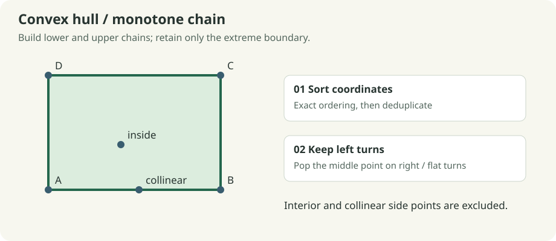
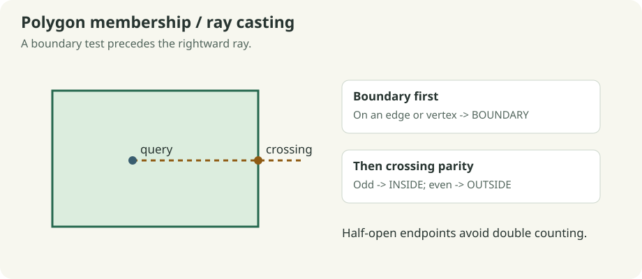
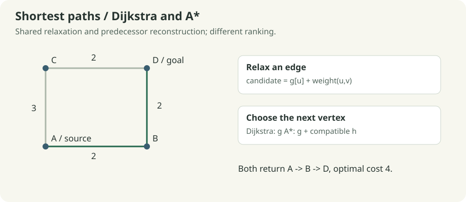
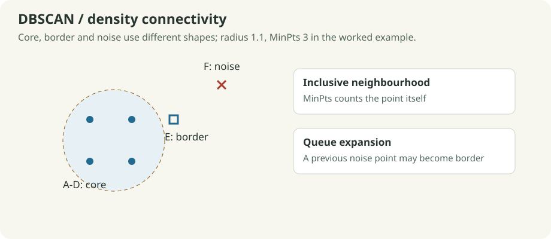
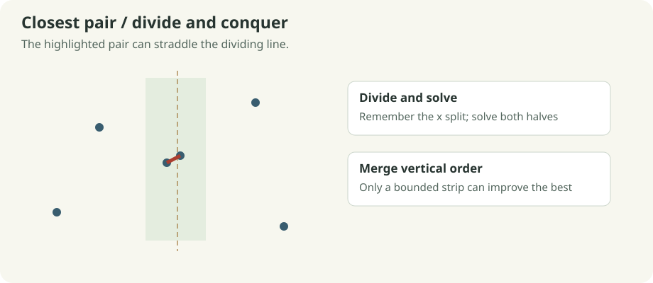
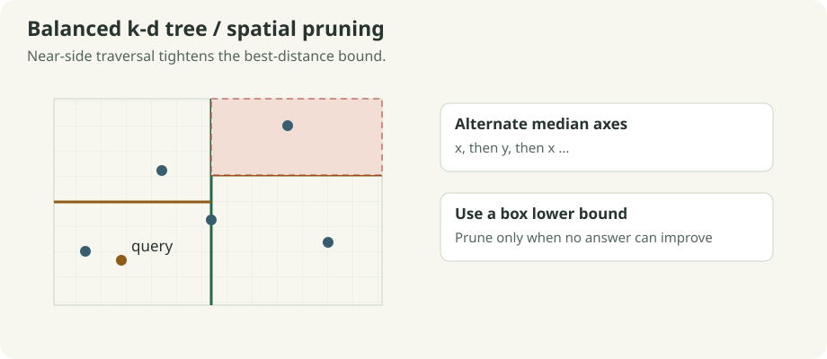
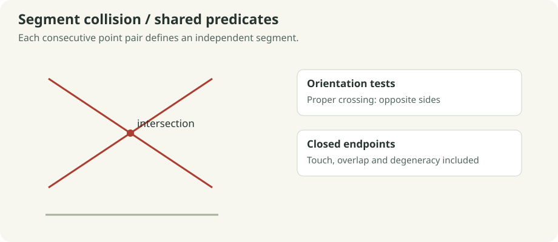

# Algorithms and recorded decisions

Every run follows **validate input → freeze scene → calculate and record → verify → inspect/export**. Algorithm work counts exclude playback and independent reference checks. Open [the offline guide](index.html) to play recordings exported directly by the C++ engine.

## 1. Convex hull: monotone chain



The convex hull is the smallest convex boundary containing all input points. Sort by exact `(x, y, input ID)`, remove duplicate coordinates, then build lower and upper chains. If the newest three vertices turn clockwise or remain collinear, remove the middle vertex. Join the two chains without repeating their endpoints.

```text
ids = sort_and_deduplicate(points)
for order in [left_to_right, right_to_left]:
    chain = []
    for p in order:
        while chain has two vertices and orientation(last_two, p) <= 0:
            remove last vertex
        append p
join lower and upper chains without duplicate endpoints
```

For `(0,0), (4,0), (4,3), (0,3), (2,1), (2,0)`, the hull is the four rectangle corners. The two additional points do not become hull vertices. Exact duplicates collapse; collinear sides keep only extreme endpoints. Empty, singleton and all-collinear inputs are valid.

**Recorded:** candidate, removed point and accepted chain; final closed boundary. **Check:** convex turns and containment of every input. **Computation:** O(n log n) time, O(n) auxiliary storage, excluding trace and verification. A hull can enclose empty space; it does not identify a density cluster.

## 2. Geofence: boundary-first ray casting



Validate a simple nonzero-area polygon. First test whether the query lies on any closed edge. Otherwise cast a ray to the right and toggle parity at every crossing. The test `(a.y > q.y) != (b.y > q.y)` gives a half-open endpoint rule, preventing a vertex from being counted twice; horizontal edges do not divide by zero.

```text
for each polygon edge:
    if query lies on edge: return BOUNDARY
inside = false
for each edge spanning query.y under the half-open rule:
    x_cross = a.x + (query.y-a.y) * (b.x-a.x) / (b.y-a.y)
    if x_cross > query.x: inside = not inside
return INSIDE if inside else OUTSIDE
```

In the rectangle `(0,0), (4,0), (4,3), (0,3)`, `(2,1)` is inside, `(4,1)` is boundary and `(5,1)` is outside. Concave gallery polygons demonstrate that bounding-box containment is insufficient.

**Recorded:** tested edges and ray crossings. **Check:** winding-number classification. **Computation:** O(m) per query and O(1) working storage; polygon validation separately costs O(m²). Geometry uses the common tolerance described below.

## 3. Dijkstra: nonnegative shortest paths



Set the source distance to zero and all others to infinity. A min-heap selects the unsettled vertex with the least tentative cost. Relax an open edge when `g[u] + weight < g[v]`, updating distance and predecessor. Stale heap entries are discarded. Once the goal is settled, follow predecessors back to the source.

```text
push (score=0, cost=0, source)
while heap is not empty:
    pop least (score, cost, ID)
    skip stale or already-closed entry
    close vertex; stop if goal
    for each open neighbour:
        if path through vertex improves neighbour:
            update cost and parent; push new entry
```

For edges `A-B:2, A-C:3, B-D:2, C-D:2`, source A and goal D, the optimal route is A-B-D with cost 4. Blocking B-D forces A-C-D with cost 5. Blocking both incoming goal links returns **NO PATH**, not a fabricated route. The source equal to the goal costs zero. Graphs are simple, undirected and nonnegative; self-links and duplicate pairs are rejected.

**Recorded:** costs, predecessors, closed vertices and frontier. **Check:** Bellman-Ford optimal cost plus returned path edges and summed cost. **Computation:** O((V+E) log V) for the bounded simple graph with lazy binary-heap entries; O(V+E) graph/heap storage, excluding trace and checks.

## 4. A*: compatible goal-directed search

A* reuses the Dijkstra search and changes only the ranking to `f(v)=g(v)+h(v)`. Ordinary distance graphs use Euclidean distance to the goal. The regular grid uses Manhattan distance divided by its 60-unit spacing. Every open edge is checked: its cost must cover the corresponding geometric lower bound. If any edge is incompatible, the run uses `h=0` and reports the fallback.

For A=(0,0), B=(2,0), C=(0,2), D=(2,2) with the preceding edge weights, A* prioritizes B, then D. Both algorithms return cost 4; A* can settle fewer vertices. The number saved depends on layout, obstacles, costs and ties. Moving grid points clears the grid assumption. An admissible estimate must use the same units as the edge costs.

**Recorded/check:** the route trace also includes f scores; Compare runs Dijkstra on the identical input. **Computation:** the same worst-case bound as Dijkstra here, with a consistent enabled heuristic. A* is not promised to be faster on every sample.

## 5. DBSCAN: density-connected groups



A point is **core** if its inclusive radius neighbourhood contains at least MinPts points, including itself. A non-core neighbour of a core point is **border**. Points not reached by any core component are **noise**. A queue expands through connected core neighbourhoods, so a cluster need not be circular or convex.

```text
visit points in ascending input order
query neighbours of each unvisited point
if too few: mark provisional noise
otherwise start a cluster and queue its neighbours
while queue is not empty:
    pop point; query it once if unvisited
    if core: enqueue its neighbours deterministically
    if unassigned or provisional noise: assign this cluster
```

For A=(0,0), B=(1,0), C=(0,1), D=(1,1), E=(2,1), F=(6,6), radius 1.1 and MinPts 3, A-D are core, E is border and F is noise. A provisional noise point may later become border. When a border point touches multiple components, the first cluster in deterministic input order wins.

**Recorded:** radius query, active neighbours, labels, core/border/noise kind and expansion queue. **Check:** an independently constructed core-neighbour graph and border assignment. **Direct computation:** O(n²) distance work, O(n) working storage with per-query neighbourhoods, excluding trace and reference storage.

## 6. Indexed DBSCAN: shared expansion, different query Strategy

The cluster expansion above is unchanged. A `SpatialIndex` pointer selects either `LinearIndex` or `KDTree`. The tree skips boxes outside the radius before testing individual points. Returned neighbour IDs are sorted, preserving deterministic assignments and exact scan/indexed agreement.

The build has expected O(n log n) time; query performance depends on data distribution and radius. Indexed DBSCAN can still perform O(n²) distance work when neighbourhoods cover most of the data. Compare reports distance tests; it excludes tree construction and verification and is not an elapsed-time benchmark. The sample catalogue records both implementations on the same scenes.

## 7. Closest pair: divide, solve and merge



Sort points by x once. Split at the midpoint; solve the left and right ranges; merge their y order using a temporary buffer. A globally best distance bounds a strip about the dividing line. In y order, compare each strip point with at most the next seven candidates, stopping earlier when the vertical separation is already too large.

```text
sort by x; check adjacent exact duplicates
solve(range):
    if at most three points: test all pairs; sort range by y
    else:
        remember x split; solve left; solve right
        merge y-sorted ranges
        collect points within best distance of split
        test bounded following candidates in y order
```

For `(0,0), (3,0), (4,4), (4.2,4.1), (8,2)`, the best pair is `(4,4)` and `(4.2,4.1)` with distance √0.05 ≈ 0.223607. Duplicates give distance zero. Fewer than two points give no pair and an infinite distance. Equal-distance candidates are compared by their sorted input-ID pair.

**Recorded:** recursive region, strip, tested pair and current best. **Check:** exhaustive all-pairs distance. **Computation:** O(n log n) time and O(n) auxiliary storage plus recursion; maintaining y order avoids an extra logarithmic sorting factor.

## 8. Balanced k-d tree: nearest and radius



Alternate x and y axes, select a median with `nth_element`, and recursively split both ranges. Nodes retain their axis-aligned regions. For nearest search, visit the side containing the query first. The squared distance from the query to a box is a lower bound for every point in it; a strictly worse box can be pruned. Equality remains searchable so the lowest-ID tie is retained.

Radius search prunes when the box lower bound exceeds radius² and includes points at exact equality. Answers are returned in ascending ID order. A fresh tree is built for every input snapshot, so moving points cannot leave a stale index.

For A=(0,0), B=(1,0), C=(0,1), D=(1,1), E=(2,1) and query `(2,0)`, B and E tie at distance 1; B has the lower ID. Radius 1.1 includes B and E. Empty input gives no nearest answer and an empty radius result.

**Recorded:** axis/median construction, visited regions, current best and dashed pruned regions. **Check:** exhaustive scan. **Computation:** expected O(n log n) build with median selection and O(n) storage. Nearest/radius queries can visit O(n) nodes in the worst case; radius output also costs O(k log k) here because IDs are sorted.

## 9. Segment collision and shared predicates



The signed cross product determines orientation. Proper intersections require the endpoints to lie on opposite sides of each other's segment. Collinear on-segment tests additionally include endpoint touches, overlaps and zero-length segments lying on another segment.

Collision mode interprets consecutive input pairs as independent segments and tests each unordered pair once. For `(0,0)-(4,4)` and `(0,4)-(4,0)`, there is one intersecting pair. Adding a disjoint segment does not change that count. An unmatched final point is unused.

**Recorded:** the two segments being tested and all intersecting segments found so far. **Check:** expected crossing/touch/overlap/degenerate tests; no separate runtime oracle is claimed. **Computation:** O(s²) time for s segments; O(1) working state excluding retained collision lines and trace.

## Numeric, ordering and storage policies

World coordinates are finite doubles bounded to ±10,000,000. Orientation compares the cross product against `1e-9 × max(1, |AB| × |AC|)`; on-segment bounds use an edge-length-scaled pad. Sorting uses strict exact coordinates, never an approximate comparator. Radius membership is inclusive without an extra tolerance. These are floating-point predicates, not exact arithmetic.

Scene bounds are 256 points, 256 polygon vertices and 4,096 graph edges. A trace stores at most 4,096 snapshots. When capped, it retains its prefix and final state and explicitly reports truncation. Snapshot creation, storage, rendering and reference verification have additional costs beyond the algorithm bounds above. Runtime verification may be quadratic; measured operation counts deliberately exclude it.

## How security integrates these algorithms

`SecurityConsole::scene()` creates an ordinary `Scene` from either projected events or scaled device rates. Geographic membership uses the same boundary predicates; proximity uses the same k-d tree; grouping uses the same direct/indexed DBSCAN strategies. Source linkage stays in the security model while the algorithm engine processes coordinates and parameters. [The security guide](SECURITY.md) defines the units, filtering and evidence contract.
