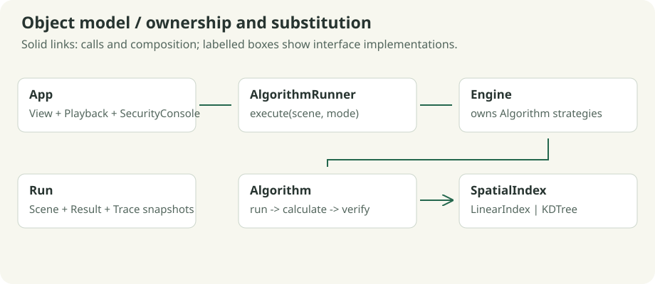

# OOP and C++ design

GeoViz separates editable input, computation, recorded decisions, presentation and persistence. The engine is compiled without raylib, so tests can execute algorithms without opening a window.

The desktop presentation is also composed from focused components. `SceneCanvas` receives a `CanvasContext` of const model references and renders surfaces, partitions, topology, highlights, points and queries as separate layers. It cannot edit input or advance playback. `SettingsPanel` owns its modal field buffer, parses values and validates detached candidate models. `App` commits a complete candidate only after validation succeeds, then coordinates history and execution. These components live in `src/ui_canvas.hpp` and `src/ui_settings.hpp`; procedural surface artwork is isolated in `src/canvas_art.hpp`.



## Encapsulation and model invariants

`Point` validates finite, bounded coordinates. `Scene` privately owns points, polygons, edges and parameters. Collection getters return const references. Mutators such as `removePoint()` preserve topology by deleting incident edges and remapping remaining endpoint indices. Setters advance the scene revision. `setEdges()` validates a candidate copy before replacing the current graph.

`Result` owns the answer, counters, verification status and trace. `Run` owns an independent input/result snapshot and exposes const access. Editing the active scene cannot silently alter a historical run. `Trace` caps stored frames and explicitly preserves the final frame when truncated.

These are practical invariants: private fields and const access prevent UI code from creating untracked mutations or leaving graph references attached to deleted points.

## Abstraction, inheritance and runtime polymorphism

`Algorithm` defines `mode()` and the protected virtual `calculate()`. Its public `run()` validates input, dispatches calculation and verifies the result. This **Template Method** keeps the lifecycle consistent while each derived class implements its algorithm.

`Engine` implements the abstract `AlgorithmRunner` interface and owns concrete algorithms in `std::map<Mode, std::unique_ptr<Algorithm>>`. `App` stores an `AlgorithmRunner` pointer. Calling `execute()` selects a Strategy and calls the derived implementation through the base interface.

```cpp
std::unique_ptr<AlgorithmRunner> runner = std::make_unique<Engine>();
Result result = runner->execute(scene, Mode::Hull);
```

`RouteAlgorithm` shares heap search, relaxation, recording and route reconstruction. `DijkstraAlgorithm` supplies a zero heuristic; `AStarAlgorithm` supplies the distance estimate. This avoids duplicating a full search loop merely to change its ranking function.

`SpatialIndex` declares `nearest()` and `radius()`. `LinearIndex` and `KDTree` implement interchangeable query strategies. DBSCAN owns one index through `unique_ptr<SpatialIndex>` and shares its cluster-expansion code across scan/indexed modes. `LogAdapter` and `CsvLogAdapter` provide the same abstraction at the file-ingestion boundary.

All owning polymorphic bases have virtual destructors. `override` makes signature mismatches a compiler error, and `final` marks implementations that are not extension points.

## Composition and resource ownership

`Scene` contains model objects; `Result` contains `Stats` and `Trace`; `Run` contains a `Scene` and `Result`; `App` contains the playback, view and security model. Composition expresses these ownership relationships without forcing unrelated types into an inheritance hierarchy.

`Window`, `Ui` and `DrawingSession` use **RAII** to pair graphics acquisition/release and begin/end operations. Copying resource owners is disabled to prevent double cleanup. `unique_ptr` expresses exclusive ownership; vectors and value snapshots manage their storage automatically. The code does not use owning raw `new`/`delete` pairs.

## C++ features used with a purpose

| Feature | Concrete use and significance |
| --- | --- |
| Constructors and private state | Establish valid points, graph edges and resource ownership |
| Const references and const methods | Inspect large collections without copying or permitting mutation |
| `std::unique_ptr`, `make_unique` | Own algorithm/index/adapter strategies and release them safely |
| Move semantics | Transfer vectors and completed results instead of repeatedly copying ownership |
| `enum class` | Keep mode and interaction-state values scoped and typed |
| Virtual functions, `override`, `final` | Interchange behavior through checked public contracts |
| STL containers | Vectors for geometry, heaps for route frontiers, queues for density expansion, maps for devices/registry |
| STL algorithms | Exact sorting, median selection, merging and duplicate removal |
| Lambdas and structured bindings | Local comparison/trace helpers and readable heap/adjacency processing |
| `std::function` | Recursive local traversal for closest pair and tree queries |
| Exceptions and candidate copies | Reject malformed input while preserving usable current state |
| `std::filesystem` and streams | Portable path handling, versioned input files and precise serialization |
| Compile-time assertions | Tests verify abstract interfaces, virtual destruction and read-only model access |

## Follow one execution

`App::execute()` calls `AlgorithmRunner::execute()` → `Engine` selects a concrete `Algorithm` → `Algorithm::run()` validates, calculates and verifies → `Run` freezes input/result → `Playback` selects a recorded `Frame` → the canvas draws it. The renderer never determines algorithm answers. `SceneIO` exports the same snapshot used for the display.

The design intentionally remains a bounded desktop application. Algorithms, domain adaptation and presentation are separate; no service framework or additional algorithm family is needed to extend samples or improve visual presentation.
