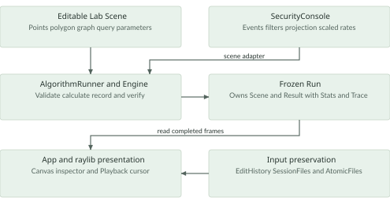
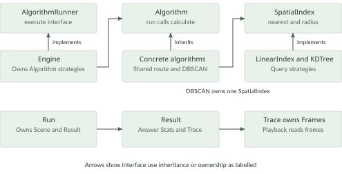
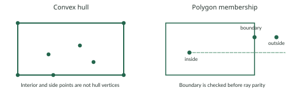
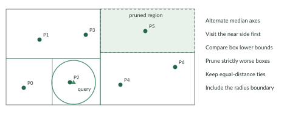
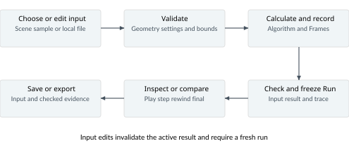
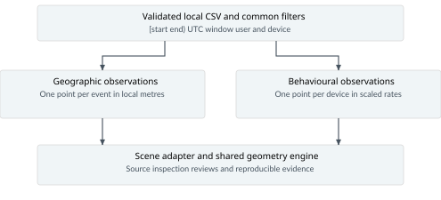

# GeoViz

## Computational Geometry Visualizer and Spatial Security Console

**Project Report**

Submitted for **Object Oriented Programming**

**Satyam Dhal**  
Roll number **b425050**  
Branch and section **CSE-B**  
Institute email **b425050@iiit-bh.ac.in**

**International Institute of Information Technology Bhubaneswar**  
Gothapatna, Bhubaneswar, Odisha, India  
**31 October 2026**

Application version **2.0.0**  
Source revision **1076a66fd4950341132eaefd658d82a7cff80543**

<!-- pagebreak -->

# Abstract

GeoViz is an offline C++17 desktop application for learning computational geometry through editable inputs, recorded decisions and checked results. Instead of displaying only a final answer, it records intermediate states that a user can play, pause, step through and rewind. The same engine supports a Spatial Security Console that converts synthetic location and device-activity records into geometric observations.

The application provides ten modes: monotone-chain convex hull, polygon membership, Dijkstra shortest paths, A* search, direct-scan DBSCAN, divide-and-conquer closest pair, k-d nearest neighbour, k-d radius search, indexed DBSCAN and segment collision. Sixty deterministic Lab inputs and nine security scenarios demonstrate ordinary cases, boundaries and less intuitive behaviour. Users can edit geometry, compare paired algorithms, inspect source records and save reproducible inputs and evidence.

The design separates domain models, algorithm execution, trace playback, security processing, persistence and rendering. Encapsulation protects scene topology; polymorphic interfaces select algorithm and spatial-index strategies; value snapshots preserve completed runs. Undo and redo, staged saves, recent sessions and recovery snapshots support reliable interaction. The raylib interface remains separate from the engine, allowing computation and tests to run without graphics.

A fresh GCC 15.2 Release build on 31 October 2026 passed all nine registered CTest suites, including 1,766 engine checks, 26 product reliability checks and structured-evidence validation. The published source revision also passed all six GitHub Actions jobs. The results demonstrate reproducible algorithm behaviour within explicit input limits. Synthetic security outcomes remain investigation examples: density noise and geographic outliers do not establish malicious activity.

**Keywords** Computational geometry, C++17, object oriented programming, raylib, algorithm visualization, DBSCAN, shortest paths, spatial indexing, reproducibility.

## Project profile

| Attribute | Delivered scope |
| --- | --- |
| Application | GeoViz 2.0.0, portable Windows desktop program |
| Learning workspace | Ten algorithm modes and 60 generated Lab inputs |
| Security workspaces | Geographic events and scaled device behaviour |
| Security scenarios | Nine catalogue entries using synthetic local CSV data |
| Core evidence | Frozen runs, checks, operation counts and reloadable snapshots |
| Submission | Source, executable, tests, data, documentation and project report |

<!-- pagebreak -->

# Contents

<!-- toc -->

- [Abstract](#abstract)
- [1 Introduction and objectives](#1-introduction-and-objectives)
- [2 Requirements and delivered scope](#2-requirements-and-delivered-scope)
- [3 Technology and deployment](#3-technology-and-deployment)
- [4 System architecture and object oriented design](#4-system-architecture-and-object-oriented-design)
- [5 Algorithms and numerical policies](#5-algorithms-and-numerical-policies)
- [6 Execution interaction and persistence](#6-execution-interaction-and-persistence)
- [7 Spatial Security Console](#7-spatial-security-console)
- [8 User interface and demonstration](#8-user-interface-and-demonstration)
- [9 Verification methodology](#9-verification-methodology)
- [10 Results and evaluation](#10-results-and-evaluation)
- [11 Limitations and future improvements](#11-limitations-and-future-improvements)
- [12 Conclusion and requirement traceability](#12-conclusion-and-requirement-traceability)
- [References](#references)
- [Appendix A Control reference](#appendix-a-control-reference)
- [Appendix B Saved formats and source map](#appendix-b-saved-formats-and-source-map)

<!-- endtoc -->

<!-- pagebreak -->

# 1 Introduction and objectives

## 1.1 Problem statement

Computational geometry algorithms often produce a compact answer while hiding the decisions needed to reach it. A convex polygon does not show which candidate points were removed; a route does not show the frontier and relaxed edges; a cluster colour does not explain core points, border points or noise. Static examples also make it difficult to investigate how an answer changes after an input edit.

GeoViz addresses this problem with an interactive environment in which a user creates or loads a scene, selects an algorithm, records a run and examines its decisions. A common representation connects input geometry, algorithm state, textual explanations, pseudocode references and the final answer. Result checks help distinguish a plausible picture from a correct calculation.

## 1.2 Project objectives

The first objective is to implement the complete set of requested geometry, routing, clustering and proximity functions. Each algorithm must expose meaningful intermediate states and handle documented boundary cases. Paired algorithms must be comparable on identical inputs rather than on unrelated examples.

The second objective is to demonstrate object oriented design through responsibilities that can be explained and tested independently. Scene ownership, geometry predicates, algorithm strategies, spatial indexes, security ingestion, recorded runs and graphics resources each have an explicit role.

The third objective is to apply the same algorithms to an understandable analysis task. Geographic observations support permitted-region and proximity queries; scaled device rates support density analysis. Source links, parameters and analyst notes make the resulting evidence inspectable and reproducible.

The fourth objective is dependable desktop use. Invalid settings and failed imports must preserve existing input. Edits must invalidate stale answers. Saving, undo, recovery and clear status messages must support repeated experimentation and presentation.

## 1.3 Scope and intended users

The primary users are students demonstrating algorithms and evaluators reviewing C++ implementation and OOP concepts. The security workspaces provide a second domain example for exploratory analysis of approved local exports. Maps, logistics, robotics, sensors and GIS supply motivating use cases rather than separate production integrations.

GeoViz runs locally without an account or network connection. The delivered Windows executable includes its required assets and sample data. Source-based engine builds support automated testing without a display. The implementation and results described here correspond to source revision 1076a66f [1].

<!-- pagebreak -->

# 2 Requirements and delivered scope

## 2.1 Functional requirements

| Requirement | Implemented behaviour |
| --- | --- |
| Edit spatial input | Add, select, drag and remove points; edit polygons, edges, queries and parameters |
| Explain computation | Record decisions, explanations, pseudocode positions and intermediate geometry |
| Control playback | Play, pause, step in either direction, rewind, jump to the final frame and vary speed |
| Compare results | Pair Dijkstra with A* or scan DBSCAN with indexed DBSCAN on the same input |
| Reproduce work | Save exact input, retain immutable runs and export summaries with adjacent snapshots |
| Inspect security data | Filter local records, switch views, inspect contributing records and retain reviews |
| Preserve input | Undo and redo, save checkpoints, recovery generations and rollback after reported failures |

## 2.2 Algorithm coverage

| Family | Available modes | Principal result |
| --- | --- | --- |
| Boundaries | Convex hull and geofence | Extreme boundary; inside, boundary or outside |
| Routing | Dijkstra and A* | Optimal cost, route or explicit no-path result |
| Density | DBSCAN scan and DBSCAN indexed | Cluster identifiers and core, border and noise kinds |
| Proximity | Closest pair, KD nearest and KD radius | Minimum pair; query neighbour; inclusive radius matches |
| Intersections | Segment collision | Intersecting segment pairs and highlighted segments |

## 2.3 Quality and acceptance requirements

Algorithms must be deterministic for a frozen input, expose consistent boundary policies and pass appropriate reference or invariant checks. Route costs must agree under the heuristic contract; scan and indexed clustering must preserve the same labels. Saving and reloading must reproduce input accurately, and editing must not silently change a historical result.

The system bounds scene and trace sizes, rejects non-finite values and keeps graphics timing separate from algorithm operation counts. Text, shapes and line styles supplement colours. The interface provides keyboard controls, adjustable text and a presentation layout.

<!-- pagebreak -->

# 3 Technology and deployment

## 3.1 Implementation stack

| Component | Technology and purpose |
| --- | --- |
| Language | C++17 with standard containers, algorithms, filesystem support and smart pointers |
| Desktop graphics | raylib 5.5 for drawing, input, windowing and resource handling [2] |
| Build system | CMake 3.21 or newer, Ninja and a compatible C++ toolchain |
| Windows toolchain | GCC 15.2; default installation under C:\raylib\w64devkit |
| Verification | CTest executables, optional Python evidence checks and GitHub Actions |
| Presentation assets | Bundled Lato Regular and Bold fonts, icons and offline canvas artwork |

The engine library contains geometry, algorithms, input/output, security processing, sample generation and session support. It has no raylib dependency. The desktop target links this engine with the rendering and input modules. Python is optional for development checks and is not needed to run GeoViz.

## 3.2 Portable execution

Extract the complete project or release package into a writable directory. Keep GeoViz.exe, assets/ and data/ together, then launch GeoViz.exe. The program creates output/ for local saves, recovery and exports. The minimum desktop size is 960 by 640 pixels. The --root option selects a different project data directory.

Missing required assets produce actionable startup feedback. The Windows package embeds UTF-8 process configuration, and verification includes a folder containing spaces and the character Omega. Fonts retain their original coverage; Unicode path handling does not imply universal glyph support.

## 3.3 Build and test

```powershell
powershell -NoProfile -ExecutionPolicy Bypass -File .\build.ps1 -Run
```

For engine-only work, the graphics dependency can be disabled:

```sh
cmake -S . -B build/core -G Ninja -DGEOVIZ_BUILD_APP=OFF
cmake --build build/core --parallel 4
ctest --test-dir build/core --output-on-failure
```

CMake also provides engine-release, engine-debug and Linux sanitizer presets. GEOVIZ_FETCH_RAYLIB=ON builds the pinned raylib 5.5 revision when a compatible installed library is unavailable. The source layout and these build paths allow algorithm review separately from platform graphics setup.

<!-- pagebreak -->

# 4 System architecture and object oriented design

## 4.1 Separation of responsibilities

GeoViz uses a shared computational engine beneath an application coordinator. Lab scenes and security-derived scenes enter the same AlgorithmRunner interface. The engine selects a concrete algorithm, records decisions and checks the result. Rendering consumes the completed run and its current playback frame.



The domain layer owns geometric and event data. Scene encapsulates points, polygon vertices, edges, query locations and algorithm parameters. SecurityConsole owns source events, filters, projection settings, fence and analyst review. Its scene() method converts a view into ordinary geometry without moving source-record concerns into the algorithms.

The execution layer owns the algorithm registry and the shared validate, calculate and verify lifecycle. Result contains the answer, work counters, trace and check status. Run retains a value snapshot of input and result, so later edits cannot alter a completed calculation.

The application layer coordinates commands, input handling, inspector content and drawing through separately compiled modules. SceneCanvas handles canvas drawing; SettingsPanel prepares candidate settings. EditHistory tracks input states, while SessionFiles handles recent sessions and recovery policy. AtomicFiles stages related output before publication.

This arrangement supports two useful forms of independence: headless tests exercise the engine without opening a window, and playback can change its cursor without recalculating an algorithm. Domain processing therefore remains inspectable even when presentation speed or layout changes.

<!-- pagebreak -->

## 4.2 Domain model and class relationships



| Class or interface | Responsibility and contract |
| --- | --- |
| Point, Edge and Scene | Valid coordinate values, graph topology, parameters and revision tracking |
| AlgorithmRunner and Engine | Application-facing execution contract and owning strategy registry |
| Algorithm | Public run lifecycle with a protected algorithm-specific calculation |
| SpatialIndex | Interchangeable nearest and radius query interface |
| Frame, Trace and Playback | One decision snapshot, bounded frame storage and a separate replay cursor |
| Result and Run | Checked answer and independent completed input/result snapshot |
| LogAdapter and CsvLogAdapter | Abstract ingestion boundary and strict local CSV implementation |
| Event and Observation | Source record and a view point linked to its contributing record indices |
| SecurityConsole | Filtering, derived scenes, projection, aggregation, review and evidence |
| EditHistory and SessionFiles | Undo/redo state, recent paths and complete recovery snapshots |

Scene collections are exposed through const views. Mutators preserve model invariants: removing a point removes its incident edges and remaps remaining indices. Revision tokens allow dependent views and history to detect a replacement model even when its contents resemble an earlier one.

The class relationships favour composition for ownership and inheritance for interchangeable behaviour. A run owns values; an engine owns algorithm objects; DBSCAN owns an index strategy. These relationships make lifetime and mutation rules visible in the types.

<!-- pagebreak -->

## 4.3 Object oriented principles and language mechanisms

**Encapsulation** keeps model state private and routes edits through validated operations. Settings use a detached edit buffer, allowing all related values to be checked together before replacing active settings. Historical runs expose const input and result access.

**Abstraction and runtime polymorphism** separate clients from implementations. App depends on AlgorithmRunner. Engine stores unique_ptr<Algorithm> objects and dispatches through a common interface. LinearIndex and KDTree implement SpatialIndex; CsvLogAdapter implements LogAdapter. Owning polymorphic bases have virtual destructors, and override checks derived signatures.

**Template Method** appears in Algorithm::run: validation and verification surround each derived calculate() implementation. **Strategy** appears in the engine registry and in DBSCAN neighbourhood queries. The two clustering modes share expansion code while changing their query strategy. Dijkstra and A* similarly share the complete route loop and vary the heuristic.

**Memento** appears in EditHistory, which retains up to 128 input states, supports undo and redo, and removes the redo branch when a new edit is made. Completed-run snapshots serve a different purpose: they preserve calculation evidence rather than replace the input history.

**RAII and composition** manage ownership. Standard containers and unique_ptr release memory automatically. Graphics wrappers pair acquisition with cleanup. AtomicFiles cleans abandoned staging files and restores previous files after a reported publication failure. Noncopyable resource owners avoid duplicate cleanup.

```cpp
std::unique_ptr<gv::AlgorithmRunner> runner =
    std::make_unique<gv::Engine>();
gv::Scene input = gv::sampleScene(gv::Mode::Hull);
gv::Result result = runner->execute(input, gv::Mode::Hull);
gv::Run completed(input, std::move(result));
```

The example uses the execution abstraction while preserving an independent completed input. Other C++ features have specific roles: enum class makes modes type-safe; vectors hold geometry and trace state; a priority_queue ranks routing candidates; queues expand density clusters; maps own registries and device aggregates; STL sorting and median selection support spatial algorithms. Exceptions report rejected input without requiring callers to use partially valid models.

The implementation uses interfaces where behaviour varies and ordinary value types where ownership is sufficient. It does not require a separate inheritance hierarchy for every geometric record.

<!-- pagebreak -->

# 5 Algorithms and numerical policies

## 5.1 Geometry kernel and collision mode

The geometry kernel provides squared distance, distance, orientation, on-segment tests, closed-segment intersection and polygon validation. All modes use world coordinates with x increasing rightward and y upward. Screen scaling and canvas zoom do not change geometric input.

For points A, B and C, orientation uses the signed cross product:

```text
cross = (Bx - Ax)(Cy - Ay) - (By - Ay)(Cx - Ax)
tolerance = 1e-9 * max(1, length(AB) * length(AC))
```

A cross product beyond the tolerance selects a left or right turn; a value within it is treated as collinear. On-segment bounds use a length-scaled pad. Sorting uses exact coordinate ordering rather than a tolerance-based comparator, preserving the strict ordering expected by STL algorithms. These policies are finite-precision approximations, not exact geometric predicates.

Polygon validation rejects invalid coordinates, too few distinct vertices, zero area, folded boundaries and self-intersections. Membership classification first checks boundary segments, making edge and vertex queries explicit rather than allowing ray parity to decide them accidentally.

Collision mode treats consecutive points as separate closed segments: points 0 and 1 form one segment, points 2 and 3 form the next, and so on. It tests every unordered segment pair. Proper crossings, endpoint touches, collinear overlaps and zero-length segments on another segment count as intersections. An unmatched final point is unused.

The reference collision scene contains four segments and reports two intersecting pairs. Traces highlight the tested pair and the segments involved in intersections. With m segments, the pair loop performs m(m-1)/2 tests and has O(m squared) calculation time. Retained intersection lines and trace snapshots consume additional storage.

## 5.2 Common input bounds

| Input | Bound or policy |
| --- | --- |
| Coordinates | Finite doubles within plus or minus 10,000,000 |
| Point and polygon counts | At most 256 each |
| Graph edges | At most 4,096; finite weights from 0 to 10 to the power 12 |
| Query radius and MinPts | Positive radius; MinPts from 1 to 256 |
| Trace | At most 4,096 frames; final state preserved when capped |

Validation and result checking are separate from the core algorithm costs stated in this chapter. Collision is labelled test-covered because it has expected-case tests but no separate runtime reference oracle.

<!-- pagebreak -->

## 5.3 Convex hull and polygon membership

**Convex hull.** GeoViz implements Andrew's monotone-chain construction [3]. Points are sorted by exact x, y and input identity, and duplicate coordinates are collapsed. Lower and upper chains are built by removing the last chain point whenever the newest triple does not make a left turn. Joining the two chains produces the boundary without repeating endpoints.

Collinear points on a hull side retain only the extreme endpoints. Empty, singleton and all-collinear inputs have defined outcomes. Recorded frames identify candidate points, removals and accepted chains. The reference scene produces seven hull vertices; runtime checking confirms convexity and containment of the input. A hull describes an enclosing boundary and can contain large empty areas between groups.

**Polygon membership.** The geofence algorithm classifies a query as inside, boundary or outside a validated simple polygon. It first checks all closed edges for boundary membership. Otherwise, a horizontal ray toggles parity whenever an edge crosses the query's y level and its intersection lies to the right.

```text
if query lies on any polygon edge: return BOUNDARY
inside = false
for each edge (a, b):
    if (a.y > q.y) differs from (b.y > q.y):
        x_cross = a.x + (q.y-a.y)*(b.x-a.x)/(b.y-a.y)
        if x_cross > q.x: inside = not inside
return INSIDE if inside else OUTSIDE
```

The half-open endpoint rule avoids double-counting a polygon vertex. Horizontal edges do not enter the division branch. The trace records tested edges and crossings; winding-number classification supplies an independent reference check.



The figure uses a rectangle with interior and collinear points. The hull retains four corners; membership distinguishes a point inside, one on the right edge and one outside. This illustrative input explains the policy independently of the application's larger built-in scenes.

Hull calculation costs O(n log n) time and O(n) auxiliary storage. Membership costs O(p) for a p-vertex polygon and constant working state; simple-polygon validation separately costs O(p squared).

<!-- pagebreak -->

## 5.4 Dijkstra and A star routing

Dijkstra and A* operate on the same undirected graph with finite, nonnegative edge weights. Blocked edges are omitted from adjacency. The search maintains tentative costs, predecessors and settled vertices. A lazy priority queue accepts improved entries and discards stale ones when popped.

Dijkstra ranks by the best known source cost. A* ranks by that cost plus an estimate of remaining cost [4, 5]. Heap entries use the tuple (f, g, vertex ID), and sorted adjacency makes ties reproducible. The selected goal is reached when it is settled, after which predecessors reconstruct the route. Unreachable goals produce an explicit NO PATH result, while a source equal to the goal has zero route cost.

```text
g[source] = 0; push (h(source), 0, source)
while frontier is not empty:
    pop the least (f, g, id); skip stale or settled entries
    settle u; stop if u is goal
    for each open neighbour (v, weight):
        if not settled[v] and g[u] + weight < g[v]:
            update g[v] and predecessor[v]
            push (g[v] + h(v), g[v], v)
```

For ordinary spatial graphs, the estimate is Euclidean distance. Built-in unit-cost grids use Manhattan distance divided by their 60-world-unit spacing. Before enabling the A* estimate, the shared search checks open edge costs and goal-specific consistency in both directions. Incompatible weights select h = 0 and disclose the fallback in the result summary. This preserves correctness for a graph whose weights are smaller than the geometric estimate.

Frames retain the frontier, settled labels, tentative g costs, f scores, predecessors and current focus. Compare executes both strategies on the same frozen input and synchronizes their traces. Bellman-Ford checks the reported optimum, and returned edges and path cost are checked separately.

The six built-in route inputs produced equal Dijkstra and A* costs. On the reference graph, Dijkstra settled nine vertices and A* five. On Island bridges both settled fourteen, demonstrating that a heuristic does not guarantee fewer expansions. Chapter 10 gives the full comparison.

With a binary heap, the standard core bound is O((V + E) log V) for the bounded simple-graph setting; lazy heap entries can occupy O(V + E) storage. Dense inputs, validation, recorded snapshots and Bellman-Ford verification add work beyond the visible route counters. Weights, coordinate units and the heuristic must describe compatible costs.

<!-- pagebreak -->

## 5.5 Direct and indexed DBSCAN

DBSCAN groups points connected through sufficiently dense neighbourhoods rather than assigning them to fixed centres [6]. GeoViz uses an inclusive radius epsilon, and MinPts includes the query point itself. A core point has at least MinPts neighbours; a border point belongs to a core-connected group without meeting the density threshold; remaining points are noise.

The implementation visits points in input order. An unvisited point is queried, and a core point starts deterministic queue expansion. Core neighbours extend the queue. A point first marked noise can later become a border point when a cluster reaches it. Sorted neighbour identities make ambiguous border assignments repeatable.

```text
for each unvisited point p in input order:
    visit p; neighbours = radius_query(p, epsilon)
    if size(neighbours) < MinPts: mark provisional noise
    else:
        start a cluster and queue p's neighbours
        while queue has a point q:
            visit q if needed; expand q if it is core
            assign unassigned or noise q to this cluster
```

Both modes use one expansion implementation. Scan mode supplies LinearIndex, which checks every point. Indexed mode supplies KDTree, which prunes regions before testing point distances. Both return inclusive neighbourhoods in stable identity order and produce the same labels and point kinds on the checked inputs.

The trace records the active radius neighbourhood, expansion queue, focus, cluster labels and core or border kinds. The result is checked against an independently built reference based on connected core components and deterministic border handling. Changing epsilon or MinPts creates a new run rather than modifying a recorded answer.

On the 26-point reference input, both modes return two clusters and two noise points. Scan mode counts 676 point-distance operations, while indexed mode counts 330. These counts describe query-distance work, excluding index construction, rendering and independent checking; they do not establish a wall-clock speedup.

Direct scans take O(n squared) time. Indexed DBSCAN can still inspect every point for every query. This implementation also sorts returned neighbourhood identities, giving an O(n squared log n) worst-case bound including that sorting. It stores cluster state and the queue in O(n) auxiliary space, in addition to the index and recorded frames.

DBSCAN radius depends on coordinate scale and density. A noise label means the selected parameters did not connect that point to a dense group. It does not, by itself, describe an error, anomaly or attack.

<!-- pagebreak -->

## 5.6 Divide and conquer closest pair

Closest-pair mode finds the minimum-distance pair among all input points. It answers a different question from finding a neighbour of a chosen query. GeoViz sorts point identities by x coordinate once, recursively solves left and right ranges and merges their y order on return.

After the two halves are solved, a strip around the dividing x coordinate contains possible cross-boundary improvements. Points in that strip are compared in y order only while their vertical separation can improve the current squared distance. Maintaining y order avoids sorting the strip independently at every recursion level.

```text
sort identities by x
solve(range):
    if range is small: test all pairs and order by y
    split at median x; solve left and right
    merge both ranges in y order
    form strip within the current best x distance
    compare y-near strip pairs and update the best pair
```

Duplicate coordinates yield distance zero. Exact-distance ties use the lexicographically smallest ordered input-index pair. Fewer than two points have no finite pair answer. Recording shows recursive regions, tested pairs, strip comparisons and the best pair found so far.

For the reference scene, the closest distance is approximately 82.462 world units. Gallery inputs include a close cross-strip pair, making it possible to inspect why testing only the separate halves would be insufficient. Exhaustive all-pairs distance supplies the runtime reference.

The core calculation takes O(n log n) time with O(n) auxiliary arrays and logarithmic recursion depth. Snapshot storage and verification are additional. The result retains the pair identities, numeric distance, work counts and check status, allowing the same output and playback interfaces to serve this mode without a special renderer lifecycle.

## 5.7 Interpreting algorithm work

Stats stores operations, neighbourhood-query counts and expanded or visited counts. The meaning of an operation depends on the strategy: route heap and edge work differs from a distance comparison. Counts are useful for comparing compatible modes on the same input; adding unrelated modes' counters does not create a common benchmark score.

Playback speed only changes how quickly frames are displayed. Core calculation, trace creation and reference verification run before playback. A shorter animation therefore does not imply a faster algorithm, and a capped trace does not imply that calculation stopped early.

<!-- pagebreak -->

## 5.8 Balanced k d tree queries

GeoViz builds a two-dimensional k-d tree using alternating x and y median splits [7]. std::nth_element selects each median, and every node retains an axis-aligned region. A new tree is constructed from each input snapshot so edits cannot leave a stale spatial partition.

Nearest-neighbour search first visits the region containing the query. The squared distance from the query to a region box is a lower bound for any point in it. A region whose lower bound is strictly worse than the current best is pruned. Equality remains searchable, preserving the lowest input index in an exact-distance tie.

Radius search uses the same traversal and box bounds. A region is pruned only when its lower bound exceeds radius squared, and a point exactly on the radius is included. Matching identities are sorted before publication. Empty input produces no nearest answer and an empty radius set.



The illustration shows alternating partitions, a query, a best-known radius and a distant region that can be pruned. Recorded frames in the application expose construction splits, visited regions, current candidates and dashed pruned regions. Exhaustive scans check both query modes.

Expected construction time is O(n log n) with O(n) stored nodes. Queries can visit O(n) points in the worst case. A radius result containing k matches also pays O(k log k) to sort their identities. A balanced tree therefore provides a useful query strategy without a universal sublinear guarantee.

<!-- pagebreak -->

## 5.9 Core complexity summary

| Algorithm | Core time | Main auxiliary storage |
| --- | --- | --- |
| Hull | O(n log n) | O(n) |
| Membership | O(p); validation O(p squared) | O(1) for the query |
| Dijkstra and A* | O((V + E) log V) in the stated graph setting | O(V + E) |
| DBSCAN scan | O(n squared) | O(n) |
| Closest pair | O(n log n) | O(n) |
| KD build and query | Expected O(n log n) build; O(n) worst query | O(n) |
| Indexed DBSCAN | O(n squared log n) worst including sorting | O(n) |
| Segment collision | O(m squared), m = floor(n/2) | Output-dependent |

Here n is the number of points, p the number of polygon vertices, V the number of graph vertices, E the number of graph edges, m the number of independent segments and k the number of radius matches. Auxiliary storage excludes the retained output and recorded trace. Spatial indexes are rebuilt for the input snapshot used by the run.

The table describes calculation, not the entire desktop execution cost. Polygon validation tests edge pairs; Bellman-Ford verifies routes; exhaustive references verify pair and neighbour answers. These checks can add quadratic work even when the selected algorithm has a smaller core bound. They provide confidence for bounded educational inputs without being counted as algorithm operations.

Trace memory depends on both the number of frames and the data retained in each frame. A route frame can hold per-vertex arrays, while a clustering frame can hold labels and queue state. Bounded frame count and input size limit storage; they do not make every frame equally small. Rendering and trace copying should therefore be considered before increasing the current limits.

The implemented distinctions matter in evaluation. Dijkstra and A* use comparable expansion counts on one graph, and the two DBSCAN modes use comparable query-distance work on one point set. Cross-mode counts and animation lengths have different meanings and should not be treated as a universal performance ranking.

<!-- pagebreak -->

# 6 Execution interaction and persistence

## 6.1 From editable input to a frozen run



The user chooses a workspace, algorithm and input. Scene operations guard individual edits; Engine validates common execution constraints; polygon algorithms validate a completed boundary. Invalid drafts remain available for correction. A valid Run invokes the selected strategy, records intermediate decisions, checks the result and freezes input and output together.

Each Frame is a value snapshot containing only the state needed for inspection: explanation, pseudocode line, active or focused identities, chains, labels, kinds, queue, scores, costs, predecessors, lines and spatial regions as applicable. Trace stores these frames; Playback stores only a cursor, clock, interval and play state.

Rewind and step therefore read existing snapshots. They do not reverse algorithm instructions or depend on current rendering timing. Final jumps directly to the last frame. When the 4,096-frame cap is reached, middle decisions may be omitted, the cap is disclosed, and finish() preserves the final state. The complete answer remains available.

## 6.2 Editing and comparison

Input changes invalidate the current result and comparison. A new run uses the changed input, while completed historical runs retain their own copies. Choosing another algorithm retains the scene and its saved state but invalidates the old mode's trace. Playing frames and changing presentation layout do not count as input edits.

Compare executes Dijkstra and A* or the two DBSCAN strategies on the same scene and supports synchronized inspection. Prior exports preserve previous and current summaries with their scenes. These mechanisms separate algorithm comparison from input editing and make changed answers explainable.

Keyboard commands, canvas editing, native file dialogs and Windows drag-and-drop reach the same application commands. This keeps validation and invalidation behaviour consistent across interaction paths.

<!-- pagebreak -->

## 6.3 Input history save checkpoints and recovery

EditHistory stores up to 128 semantic input states. Undo and redo restore input and invalidate completed results. Equivalent edits do not create redundant history entries, and a new edit after undo removes the abandoned redo branch. Saved-state checkpoints track whether current input matches the last successful save.

Revision tokens support efficient change detection. WorkspaceView borrows models rather than copying all events or serializing the workspace every frame. Unchanged input can be recognized through revision tokens and the bounded fence draft. Changed input alone is compared with the last semantic snapshot.

SceneIO writes full-precision coordinates and reloads through validation. Security snapshots retain events, settings, fence and reviews together, so a later CSV change does not alter a saved analysis. Recent Sessions omits missing and duplicate paths. Recovery restores complete input, not the active algorithm, playback cursor or original save path.

## 6.4 Failure handling

AtomicFiles stages related files before publication and restores prior files after a reported commit failure. A rejected import constructs no partial replacement of the live workspace. A failed save leaves the input and saved-state checkpoint available, allowing Save As to a different location.

Before unsaved input is replaced, SessionFiles preserves a recovery generation. Recovery prepares all components before restoring the workspace, and incomplete or corrupt recovery cannot partially replace defaults. If recovery cannot be written while closing unsaved work, the window stays open and explains the Save As option.

Open settings and analyst-note drafts must be applied, saved or cancelled before closing. Detached settings protect active parameters when a value is rejected. Source-linked reviews are cleared on a new CSV import, while ordinary view switching preserves the current analysis context.

| Operation | Result preserved after failure |
| --- | --- |
| Rejected CSV or snapshot import | Existing models, selections and current workspace |
| Invalid settings | Active settings and editable correction fields |
| Failed save or evidence publication | Live input and previous successful save checkpoint |
| Corrupt recovery | Complete default workspace with explanatory feedback |
| Failed close recovery | Open window and unsaved input |

Staged publication handles reported I/O errors. It is not a power-loss journal, and local recovery should not be interpreted as an external backup service.

<!-- pagebreak -->

# 7 Spatial Security Console

## 7.1 Source to observation pipeline

The console reuses the geometry engine while retaining the relationship between each displayed point and its source records. Local CSV ingestion validates records before publication. A common UTC time window and exact user and device filters select the population. The start is included and the end is excluded; an asterisk selects all identities.



In the geographic view, one selected event becomes one point. Latitude and longitude are projected into local east and north metres around the configured origin:

```text
x = R * (longitude - origin_longitude) * pi/180
    * cos(origin_latitude * pi/180)
y = R * (latitude - origin_latitude) * pi/180
R = 6,371,000 metres
```

The default origin is 20.2961 degrees north and 85.8245 degrees east. Events must lie within 50 km of the origin, whose latitude is within plus or minus 80 degrees. This local equirectangular approximation is intended for a small study area.

The offline campus layer supplies illustrative roads, buildings and open areas. It is synthetic study data rather than a surveyed campus map. The permitted polygon is a separate analysis input: inside and boundary are permitted; strictly outside observations are review candidates. K-d queries measure proximity in metres, while geographic DBSCAN uses the geographic radius.

Observation retains source-event indices. Selecting a geographic point exposes its record; selecting an aggregated feature point exposes every contributing selected record. Algorithms receive ordinary Scene coordinates, while identity, raw counts, summaries and review remain in the security model.

<!-- pagebreak -->

## 7.2 Behavioural coordinates and parameter sensitivity

The feature view first applies the same filters and then groups selected events by device. Each device uses the full selected window duration, including intervals without records. Its request and failure totals are converted into rates and divided by explicit scale factors.

```text
window_minutes = (end_utc - start_utc) / 60
request_rate = sum(device_requests) / window_minutes
failure_rate = sum(device_failures) / window_minutes
x = request_rate / request_scale
y = failure_rate / failure_scale
```

Default scales are 10 requests per minute and 1 failure per minute. With 400 requests and 40 failures over ten minutes, the plotted point is (4, 4). The default feature radius is 0.8 and MinPts is 3. Feature distance is measured in this scaled plane; it is neither a geographic distance nor a failed-login percentage.

Changing the window changes denominators as well as selected records. Changing a scale changes relative distances and neighbourhoods. The sensitivity view compares nearby parameter choices for teaching; it does not estimate real-world detection accuracy. Truth labels and analyst verdicts never enter the feature coordinates or clustering decisions.

## 7.3 Review and reproducible evidence

The documented candidate rule flags a selected source event when it is strictly outside the permitted fence or belongs to a device labelled as feature-space DBSCAN noise. A device's feature flag propagates to its selected events. Geographic clustering noise is a separate view result and is not substituted for that rule.

Known synthetic truth labels produce true-positive, false-positive, true-negative and false-negative counts. Unknown labels are counted separately. Precision, recall and false-positive rate are reported as N/A when the relevant denominator is zero. Analyst verdicts, notes and review times remain separate from sample truth.

Evidence includes the selected population, source links, filters, projection origin, scales, query locations, algorithm parameters, results, checks and review context. Text, JSON, the complete security snapshot and both derived scenes are published together. The JSON schema is geoviz.evidence.v1; its FNV-1a 64-bit input hash checks consistency of canonical source records. The hash is unsigned and does not establish authenticity.

Geographic outliers and density noise prompt review. Travel, VPNs, approximate geolocation, backups and legitimate automated traffic can explain them. A labelled educational scenario cannot establish production detection performance.

<!-- pagebreak -->

## 7.4 Security inputs and scenario catalogue

The CSV adapter requires event identity, UTC timestamp, user and device identities, geographic coordinates, request and failure counts, truth label and summary. IDs must be nonempty and event IDs unique. Counts are nonnegative integers, failures cannot exceed requests, and requests cannot exceed one billion. Labels are benign, suspicious or unknown.

The parser supports quoted commas and doubled quotation marks in single-line records and requires the exact header. Files are limited to 8 MiB and 4,096 source records. Each filtered view supports up to 256 observations; users narrow filters when necessary. Windows must be positive and at most 31 days.

| Scenario | File records | Selected events | Device points | Demonstration |
| --- | --- | --- | --- | --- |
| Compact reference | 12 | 12 | 12 | Normal use, backup and an isolated failure burst |
| Campus operations | 50 | 48 | 16 | Repeated records and excluded time endpoints |
| Research network | 42 | 40 | 20 | Mixed groups and unknown truth labels |
| Perimeter inspection | 16 | 16 | 16 | Polygon corners, edges, inside and outside |
| Authentication bursts | 36 | 36 | 12 | Dense failures and an approved backup |
| Device movement | 48 | 48 | 8 | Repeated device locations across a boundary |
| Low activity telemetry | 9 | 9 | 9 | Zero activity and entirely unknown truth |
| Time window boundaries | 27 | 24 | 12 | Inclusive start, exclusive end and quoted IDs |
| Dense campus traffic | 128 | 128 | 64 | Overlapping locations and multiple density groups |

Counts were generated from the C++ catalogue loader with each scenario's supplied defaults on 31 October 2026. Selected events are the geographic points; device points are the behavioural aggregates. The perimeter scenario derives its fence from its first four observations; other scenarios use the supplied campus fence policy.

All nine scenarios are local synthetic study data. The adapter reads a selected local export and needs no credentials. Live log connectors would require a defined source and separately approved access. The delivered console does not provide authentication, encrypted evidence storage or automated incident response.

<!-- pagebreak -->

# 8 User interface and demonstration

## 8.1 Geometry laboratory


The top controls select Lab, Security map or Security features and the applicable algorithm. The main canvas displays world-coordinate geometry and algorithm state. The inspector explains the current frame, final answer, verification status and counters. The timeline and playback controls inspect the recorded sequence.

A typical demonstration starts with Lab, an algorithm and Samples. Run computes and checks the result; Play, Step and Rewind explain its reasoning. Dragging a point invalidates the result, after which Run creates a fresh trace. A paired mode can then be opened with Compare.

## 8.2 Editing and presentation

Canvas tools add and move points, construct polygons, connect graph vertices and block edges. Source, goal, selected edge weight, query position, radius and MinPts can be edited as applicable. Mouse zoom and pan support spatial inspection; Fit restores a useful view.

F1 opens the control reference, F2 selects samples and F5 toggles the presentation layout. Adjustable text, keyboard focus, labels, shapes and line styles reinforce visual distinctions. Text fields support a caret, selection and clipboard shortcuts with bounded UTF-8 storage. A compact control reference appears in Appendix A.

The interface remains an educational desktop tool. The bundled fonts do not cover every script, and the review does not claim full assistive-technology compatibility.

<!-- pagebreak -->

## 8.3 Security investigation walkthrough


Select Security map and a catalogue scenario. Review the supplied fence and source population, then run a suitable spatial algorithm. Selecting a point reveals its source identity, timestamp, raw request and failure counts, summary and current review.

Open Settings to adjust the common UTC window, exact identity filters, radii, MinPts or feature scales. Apply validates the candidate settings together. Switch to Security features to inspect one point per device and run indexed DBSCAN using the documented scales.

Select a group or isolated observation and inspect its contributing records. Benign or Suspect opens a review note; saving records the verdict, note and time separately from synthetic truth. Export then writes reproducible evidence and adjacent snapshots. Reloading a saved security snapshot reproduces input without relying on the current CSV.

## 8.4 Feedback and input preservation

The status and inspector distinguish invalid input, no path, checked results and trace truncation. Save stores editable input; Export stores result evidence. The UNSAVED marker compares input with a successful save checkpoint rather than with playback activity.

Keyboard navigation and native Windows file dialogs supplement canvas input. Opening malformed input, rejecting settings or failing a save preserves the existing workspace. Recovery is available on restart, and settings or review drafts remain available when closing is refused.

<!-- pagebreak -->

# 9 Verification methodology

## 9.1 Independent checks and invariants

| Concern | Verification approach |
| --- | --- |
| Hull | Convexity and containment invariants; duplicate and collinear expected cases |
| Membership | Winding-number reference plus edge, vertex and invalid-polygon cases |
| Routes | Bellman-Ford optimum and independent path edge/cost validation |
| DBSCAN | Independent core-component and border construction; scan/indexed agreement |
| Closest pair | Exhaustive all-pairs distances and tie cases |
| KD nearest and radius | Exhaustive scans, inclusive boundary and equal-distance ties |
| Collision | Expected crossing, endpoint, overlap and degenerate cases |
| Persistence and evidence | Precise round trips, malformed input, staged-failure rollback and JSON checks |
| Workspace and UI | Revision, undo/redo, saved-state, recovery and production command checks |

The fixed random seed 425050 makes generated reference comparisons reproducible. Checks exercise all 60 Lab samples and all nine security scenarios. Limits are tested at the maximum supported input and immediately beyond it; capped traces retain their final state and completed results.

## 9.2 Reliability and desktop verification

Product tests exercise bounded text editing, UTF-8 deletion, equivalent edits, replacement models with distinct revisions, recent-path filtering and incomplete recovery. Desktop command checks cover rejected imports, selection preservation, failed saves and refused unsaved close when recovery fails.

The documented portable-package review completed 77 states at each of three display sizes: 960 by 640, 1440 by 900 and 1920 by 1200. It covered every mode, both security views, all scenarios, intermediate frames, dialogs, comparisons, presentation and enlarged text. Asset checks and startup failures were tested after fresh extraction into a path containing spaces and Omega.

## 9.3 Scope of the evidence

Runtime reference checks add work beyond the algorithm counters. Hull invariant checks are not a general proof for every input; collision has no separate runtime oracle. Automated state checks and assistant-driven UI tasks establish observed behaviour on the tested setup, not novice-user success rates or exhaustive physical interaction coverage. No unfamiliar-user usability study is claimed.

<!-- pagebreak -->

# 10 Results and evaluation

## 10.1 Fresh build and test results

The engine was freshly configured and built with GCC 15.2, C++17 and the project's strict warning settings on 31 October 2026. All nine CTest suites passed. The result counts below describe separate suites and are not estimates of code coverage.

| Suite | Checks or generations | Result |
| --- | --- | --- |
| Geometry regressions | 24 checks | Passed |
| Routing regressions | 27 checks | Passed |
| Clustering regressions | 10 checks | Passed |
| Persistence regressions | 312 checks | Passed |
| Security regressions | 5 checks | Passed |
| Workspace transitions | 9 checks | Passed |
| Broad engine checks | 1,766 checks | Passed |
| Product reliability | 26 checks | Passed |
| Structured evidence | 4 evidence generations | Passed |

The published revision 1076a66f also has a completed successful GitHub Actions run with six jobs: GCC and Clang in Debug and Release, Linux desktop checks and Windows package verification [8]. The Linux Debug configurations enable address and undefined-behaviour sanitizers. These remote results were checked for that revision rather than inferred from the workflow definition.

## 10.2 Interpretation

The checks support determinism, model invariants, reference agreement and input preservation in the exercised cases. They include failure behaviour as well as successful demonstrations. They do not establish correctness for all floating-point configurations, every graphics driver or every possible user interaction.

For report examples, a small headless exporter executed the existing engine on every built-in Lab variant and every security catalogue entry. The comparisons on the following pages therefore use the delivered C++ implementation with supplied inputs and parameters. They are operation and result comparisons rather than timed performance benchmarks.

<!-- pagebreak -->

## 10.3 Routing and clustering comparisons

| Route sample | Equal optimal cost | Dijkstra expansions | A* expansions |
| --- | --- | --- | --- |
| Reference scene | 403.434 | 9 | 5 |
| Campus deliveries | 982.884 | 24 | 21 |
| Warehouse aisles | 966.200 | 22 | 16 |
| Valley detour | 956.556 | 17 | 15 |
| Island bridges | 1,070.000 | 14 | 14 |
| Terrace switchbacks | 861.540 | 17 | 15 |

Costs are displayed to three decimal places in world-compatible edge-weight units. Both strategies use each same generated scene and agree at stored calculation precision within the engine's verification policy. The reference graph reduces settled vertices from nine to five, while Island bridges produces no reduction. The result illustrates the role of graph structure and heuristic information without claiming a universal advantage.

| Density sample | Points | Clusters | Noise | Scan distance work | Indexed distance work |
| --- | --- | --- | --- | --- | --- |
| Reference scene | 26 | 2 | 2 | 676 | 330 |
| Festival courtyards | 52 | 3 | 4 | 2,704 | 843 |
| Curved sensor swarms | 48 | 2 | 4 | 2,304 | 602 |
| Mixed density survey | 52 | 2 | 22 | 2,704 | 728 |
| Lagoon rings | 67 | 2 | 3 | 4,489 | 921 |
| Garden islands | 76 | 4 | 4 | 5,776 | 1,230 |

The two DBSCAN strategies agree on labels and core, border and noise kinds for these inputs. The indexed counts reflect point-distance work during queries; construction and independent checks are excluded. A smaller count is evidence of pruning for that input, not a complete runtime measurement.

The mixed-density input produces 22 noise points under its supplied settings, while the curved swarms remain connected through local neighbourhoods. These outcomes make parameter choice and density connectivity visible, and show why a cluster boundary cannot be replaced by a convex hull.

<!-- pagebreak -->

## 10.4 Security candidate evaluation

The following results use each scenario's catalogue defaults, common window, supplied fence and candidate rule from Section 7.3. Evaluation units are selected source events, so one noisy device can contribute several flagged records. Unknown truth labels are excluded from the four known-label counts.

| Scenario | TP | FP | TN | FN | Unknown |
| --- | --- | --- | --- | --- | --- |
| Compact reference | 1 | 1 | 10 | 0 | 0 |
| Campus operations | 6 | 18 | 24 | 0 | 0 |
| Research network | 4 | 4 | 30 | 0 | 2 |
| Perimeter inspection | 3 | 1 | 12 | 0 | 0 |
| Authentication bursts | 6 | 3 | 24 | 3 | 0 |
| Device movement | 1 | 6 | 34 | 1 | 6 |
| Low activity telemetry | 0 | 0 | 0 | 0 | 9 |
| Time window boundaries | 0 | 0 | 24 | 0 | 0 |
| Dense campus traffic | 0 | 0 | 118 | 8 | 2 |

TP and FN refer to suspicious-labelled events; FP and TN refer to benign-labelled events. A positive result means that the candidate rule flags the event, not that an analyst has confirmed an attack.

The compact reference has candidate precision 1/(1+1) = 0.500, recall 1/(1+0) = 1.000 and false-positive rate 1/(1+10) = 0.091. Its approved backup creates a false positive. Campus operations produces eighteen false positives because the rule propagates device noise to repeated events and also considers location.

Authentication bursts misses three suspicious-labelled events. Dense campus traffic misses all eight known suspicious events under its defaults, showing that suspicious activity can belong to a dense group inside the permitted boundary. The entirely unknown low-activity scenario reports N/A for precision, recall and false-positive rate.

These results expose both over-flagging and missed cases. They support contextual source inspection and separate analyst judgement; they do not support production accuracy claims. No parameter tuning against these labels is presented as independent validation, and totals are not pooled into a representative detection rate.

<!-- pagebreak -->

# 11 Limitations and future improvements

## 11.1 Current limits

Geometry uses finite doubles and documented tolerances. Near-degenerate inputs can remain sensitive to rounding, and the local projection approximates geographic distance within a limited study area. Exact predicates or a suitable geospatial library would be needed for stronger numerical guarantees or larger regions.

The application deliberately bounds input, trace and history sizes. A 256-point scene and 4,096-frame trace support educational inspection rather than large-scale analytics. A capped trace omits some intermediate decisions while retaining the answer and final frame. Reference verification can dominate core computation on small inputs, and k-d indexing does not guarantee faster behaviour for every dataset.

The security inputs are synthetic and the candidate rule is deliberately transparent. It can flag benign automation and miss suspicious dense activity. Local files have no authentication or encrypted storage layer; evidence hashes check consistency rather than signatures or provenance. The CSV adapter is a concrete local ingestion mechanism, not a live security-service integration.

Staged saves handle reported publication failures but do not form a power-loss transaction journal. Recovery is local to the extraction directory. The supplied executable targets Windows x64, native file dialogs are Windows-only, and font coverage is limited. Automated and assistant UI review do not measure unfamiliar-user learning time or full accessibility.

## 11.2 Prioritized improvements

1. Add exact or adaptive geometric predicates for difficult degeneracies and make tolerance sensitivity easier to inspect.
2. Separate large result computation from compressed trace retention, with background execution and cancellation before increasing dataset limits.
3. Add stronger geospatial projections and independently sourced map layers with explicit coordinate-reference metadata.
4. Introduce approved source-specific event adapters, preserving schema validation, source linkage and privacy boundaries.
5. Evaluate candidate rules on independently labelled, appropriately governed datasets, with time-separated evaluation and analyst review.
6. Add authenticated evidence signing and stronger storage protections where a deployment needs provenance or access control.
7. Conduct a structured unfamiliar-user study and assistive-technology review, then improve discoverability and keyboard workflows from observed results.

These are extensions to the delivered system. They are distinct from the implemented ten-mode laboratory, indexed queries, security workspaces, playback, persistence and recovery features.

<!-- pagebreak -->

# 12 Conclusion and requirement traceability

GeoViz delivers an inspectable computational geometry laboratory and a second application of the same engine to source-linked security observations. It combines ten algorithm modes, sixty deterministic Lab samples and nine synthetic security scenarios with editable input, recorded playback, comparison and reproducible output.

The project demonstrates OOP through validated encapsulated models, polymorphic algorithms and indexes, shared execution lifecycles, composition, resource ownership and input-history snapshots. Its reliability features connect these design choices to visible behaviour: completed runs remain immutable, failed operations preserve input, and recovery restores complete workspaces.

Fresh tests and the published revision's CI results support the exercised implementation contracts. Measured route and density comparisons explain algorithm behaviour, while security results expose the candidate rule's false positives and missed cases. The resulting application is suitable for algorithm demonstration and bounded exploratory analysis with explicit assumptions.

| Requirement group | Implementation | Main report section |
| --- | --- | --- |
| Geometry kernel and boundaries | GeometryKernel, HullAlgorithm, GeofenceAlgorithm | 5.1 to 5.3 |
| Weighted and blocked routing | Shared RouteAlgorithm, Dijkstra and A* | 5.4 and 10.3 |
| Direct and indexed clustering | DBSCANAlgorithm with LinearIndex or KDTree | 5.5 and 10.3 |
| Proximity and collision | ClosestPairAlgorithm, SpatialQueryAlgorithm, CollisionAlgorithm | 5.1, 5.6 and 5.8 |
| OOP and reusable computation | Interfaces, strategies, Template Method, composition and RAII | 4 |
| Editing playback and comparisons | Scene, Frame, Trace, Playback and Run | 6 and 8 |
| Persistence and input preservation | SceneIO, AtomicFiles, EditHistory and SessionFiles | 6.3 and 6.4 |
| Security map and feature planes | SecurityConsole, Observation and CSV adapter | 7 |
| Source-linked reproducible evidence | Reviews, JSON, snapshots and consistency checks | 7.3 and Appendix B |
| Validation and evaluation | Reference checks, regressions, desktop checks and CI | 9 and 10 |

<!-- pagebreak -->

# References

[1] Satyam Dhal. GeoViz Computational Geometry Visualizer and Spatial Security Console. Source revision 1076a66fd4950341132eaefd658d82a7cff80543, 31 October 2026. The source, DESIGN, USER_GUIDE, WORKFLOW, VERIFICATION and USABILITY documents define implementation-specific behaviour. [Source repository at the documented revision](https://github.com/b425050-prog/GeoViz-Computational-Geometry-Visualizer-/tree/1076a66fd4950341132eaefd658d82a7cff80543).

[2] Ramon Santamaria and raylib contributors. raylib 5.5 release and API source. The project pins revision c1ab645ca298a2801097931d1079b10ff7eb9df8. https://github.com/raysan5/raylib/releases/tag/5.5

[3] A. M. Andrew. Another efficient algorithm for convex hulls in two dimensions. Information Processing Letters, 9(5), 216-219, 1979. https://doi.org/10.1016/0020-0190(79)90072-3

[4] E. W. Dijkstra. A note on two problems in connexion with graphs. Numerische Mathematik, 1, 269-271, 1959. https://doi.org/10.1007/BF01386390

[5] P. E. Hart, N. J. Nilsson and B. Raphael. A Formal Basis for the Heuristic Determination of Minimum Cost Paths. IEEE Transactions on Systems Science and Cybernetics, 4(2), 100-107, 1968. https://doi.org/10.1109/TSSC.1968.300136

[6] M. Ester, H.-P. Kriegel, J. Sander and X. Xu. A Density-Based Algorithm for Discovering Clusters in Large Spatial Databases with Noise. Proceedings of KDD 1996, 226-231. https://cdn.aaai.org/KDD/1996/KDD96-037.pdf

[7] J. L. Bentley. Multidimensional binary search trees used for associative searching. Communications of the ACM, 18(9), 509-517, 1975. https://doi.org/10.1145/361002.361007

[8] GeoViz GitHub Actions. Build and test run 41112934477 for revision 1076a66f. Six completed jobs, all successful; checked 31 October 2026. [Build and test results](https://github.com/b425050-prog/GeoViz-Computational-Geometry-Visualizer-/actions/runs/41112934477).

[9] International Institute of Information Technology Bhubaneswar. Official institute website and cover logo asset. https://www.iiit-bh.ac.in/ and https://www.iiit-bh.ac.in/wp-content/uploads/2024/06/iiit-logo.jpg

Implementation measurements in Chapter 10 and scenario counts in Section 7.4 were generated locally from the cited source revision on 31 October 2026. Screenshot figures use the repository's bundled application captures. Architecture and explanatory figures summarize the implemented source relationships and policies. The institute logo is reproduced from its official website for academic identification [9].

<!-- pagebreak -->

# Appendix A Control reference

| Task | Control |
| --- | --- |
| Run; play or pause | Enter; Space |
| Previous or next frame | Left; Right |
| First or final frame | Home; End |
| Change playback speed | Left bracket; right bracket |
| Help; samples; next sample | F1; F2; N |
| Cycle workspace; algorithm | F3; F4 |
| Presentation layout | F5 |
| Settings; fit view | O; F |
| Save; Save As; Open | S; Ctrl+S; Ctrl+O |
| Reload default session | L |
| Undo; redo | Ctrl+Z; Ctrl+Y |
| Export; compare; prior summaries | E; C; V |
| Point selection; edge selection | Period or comma; F6 |
| Set route source; goal | Select a point, then R; T |
| Block or unblock an edge | Select an edge, then B |
| Set query; polygon tool | Right-click; P |
| Connect existing points | Shift-click the two endpoints |
| Add or move points | Click blank canvas; drag an existing point |
| Insert at query; delete point | Ctrl+I; Delete |
| Move point; move query | Ctrl+arrows; Shift+arrows |
| Zoom; pan | Mouse wheel; middle-button drag |
| Reset security identity filters | F7 |
| Parameter sensitivity summary | F8 |
| Focus next or previous control | Tab; Shift+Tab |
| Cancel overlay or endpoint picking | Esc |
| Exit with recovery checks | Ctrl+Q or window Close |

Settings and review notes use Ctrl+A, Ctrl+C, Ctrl+X and Ctrl+V for selection and clipboard actions. Arrows and Home or End move the caret; Shift extends selection. Settings fields hold up to 128 UTF-8 bytes and review notes up to 1,024 bytes. In Samples, number keys choose an input directly. Controls apply to the active workspace and applicable algorithm.

<!-- pagebreak -->

# Appendix B Saved formats and source map

## B.1 File contracts

| File or suffix | Contents |
| --- | --- |
| .scene | GEOVIZ 1; points, polygon, graph edges, query, radius, MinPts, source, goal and grid flag |
| .security | GEOVIZ_SECURITY 2; settings, fence, source events, verdicts, notes and review times; version 1 remains readable |
| run.txt and .scene | Checked Lab result and its full-precision input snapshot |
| evidence.txt and .json | Human-readable evidence and structured geoviz.evidence.v1 data |
| evidence.txt.security | Complete source-linked security snapshot |
| evidence.txt.geo.scene and .feature.scene | Both derived view inputs; suffixes append to evidence.txt |
| previous.txt and current.txt | Completed-run comparisons with adjacent scene snapshots |
| recovery files and recovery-history/ | Complete input recovery and generations before unsaved replacement |
| recent.txt | Recently opened session paths |

The selected security algorithm can additionally export security_selected_run.txt and its scene. Loaders validate headers, counts, numeric values, quoted fields and trailing input before publication. Exact saved input is distinct from a persistent active animation.

## B.2 Event schema

```csv
event_id,timestamp,user_id,device_id,latitude,longitude,requests,failures,label,summary
```

Timestamps are integer UTC seconds. The half-open filter is start <= timestamp < end. Geographic points represent events; feature points aggregate selected records by device using the full window duration. JSON source entries retain truth, candidate reasons, review verdict, note and reviewed UTC time separately.

## B.3 Repository navigation

Domain interfaces live under include/. Core algorithms and predicates are in src/algorithms.cpp and src/geometry.cpp. Security processing is split across security.cpp, security_io.cpp, security_samples.cpp and csv.cpp. App command, input, inspector and render methods live in separate src/app*.cpp files. Tests cover the engine, regressions, product behaviour, desktop commands, structured evidence and portable packaging.

