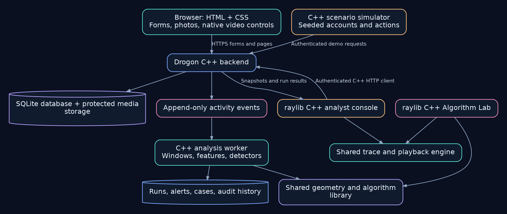
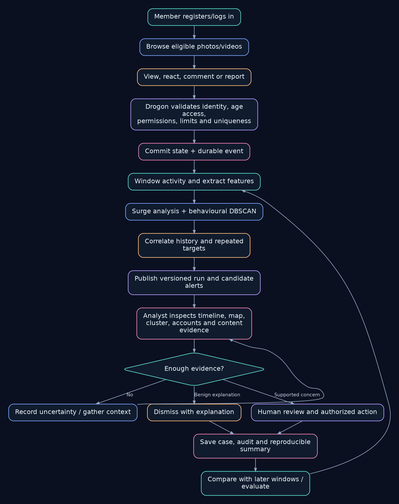
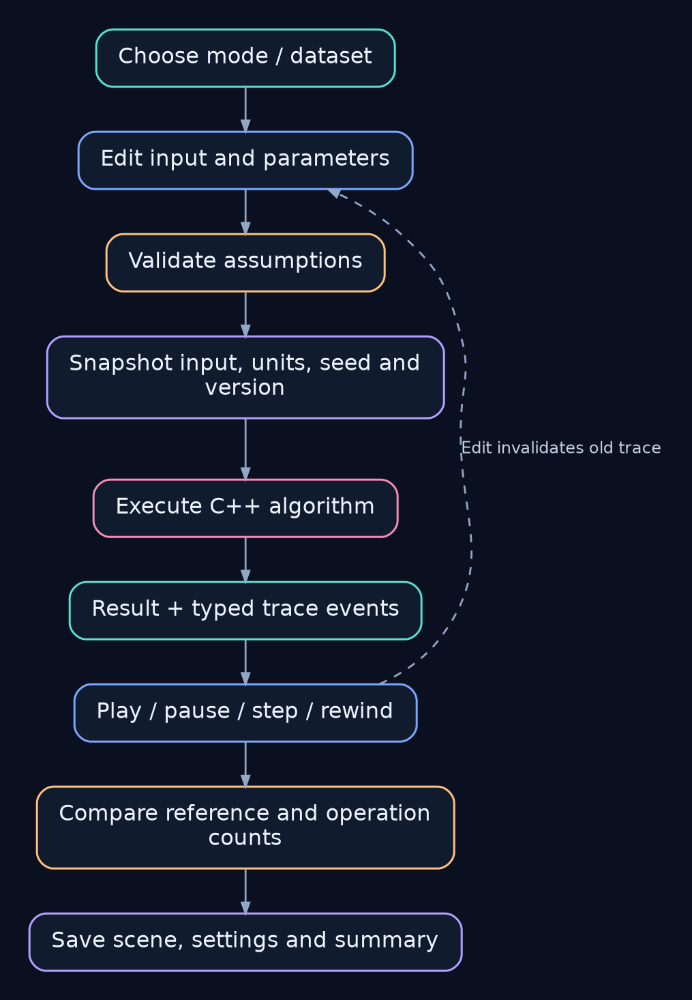

# Spatial Security Analytics Console

## Final project specification and implementation roadmap

**Author:** Satyam Dhal · **Student ID:** b425050<br>
**Branch:** Computer Science and Engineering<br>
**College:** International Institute Of Information Technology, Bhubaneswar<br>
**Subject:** OOP LAB · **Course Faculty:** Dr. Srichandan Shobhanayak

**Status:** Planning document. Features, interfaces, performance targets, and tests below are requirements to implement, not claims of working software. Nothing in this document has been implemented yet.

**Source:** [Submitted proposal](proposal/Computational_Geometry_Visualizer_Submission.pdf), expanded by the subsequent product discussion. The submitted PDF remains unchanged. This document defines the expanded product; the proposal's five algorithm demonstrations remain required.

**Implementation companion:** Start with the [documentation handbook](README.md), [engineering contracts](CONTRACTS.md) and [architecture guide](implementation/ARCHITECTURE.md). They explain how to realize this scope. Actual execution status belongs in the [validation record](testing/VALIDATION_RECORD.md).

### Reading guide

- [Product scope](#1-product-and-deliverables)
- [Language and architecture](#2-language-and-architecture)
- [Website features](#3-video-and-photo-website)
- [Events and data](#4-data-model-and-event-contract)
- [Console features](#5-security-console)
- [Detection method](#6-detection-and-evidence-pipeline)
- [Console workflow](#7-console-workflow)
- [Algorithm workflow](#8-algorithm-workflow)
- [Algorithm catalogue](#9-algorithm-catalogue)
- [OOP design](#10-oop-design)
- [Demonstration scenarios](#11-demonstration-and-scenario-catalogue)
- [Validation](#12-validation-and-acceptance-criteria)
- [Implementation milestones](#13-implementation-order)

## 1. Product and deliverables

Build a visual investigation system for **coordinated reporting and engagement abuse** on a small video/photo sharing website. Show how activity changes, which accounts behave similarly, what historical evidence supports an alert, and how an analyst reaches a decision.

The console must distinguish **unusual volume**, **behavioural similarity**, and **evidence supporting coordination**. It cannot establish whether a report is false without reviewing the content and applicable policy. An honest, coordinated response to a real violation is an explicit evaluation scenario.

### 1.1 Three connected applications

| Part | Deliverable |
| :--- | :--- |
| Demo website | An original, Instagram-inspired photo/video website with accounts, feeds, engagement, reporting, and age-restricted posts. |
| Analyst console | A raylib desktop application showing timelines, geographic activity, behavioural clusters, account histories, cases, and recorded decisions. |
| Algorithm Lab | An interactive workspace demonstrating the five proposal algorithms, with shared trace playback and optional geometry/graph extensions. |

Supporting deliverables: a Drogon C++ server, persistent database, C++ scenario simulator, editable local sample scenes, labelled evaluation datasets, tests, experiment summaries, screenshots/GIFs, and Markdown documentation.

### 1.2 Scope levels

| Level | Meaning |
| :--- | :--- |
| **Required** | Part of the first complete project, including the five proposal modes and the end-to-end security workflow. |
| **Enhancement** | A planned improvement after the required workflow is validated. |
| **Optional** | A useful extension with its own acceptance criteria; not a prerequisite for completion. |
| **Research** | An experiment requiring evidence before inclusion in product decisions. |

The catalogue is comprehensive for this product's identified needs. It is not a commitment to implement every possible algorithm. An optional feature becomes required only through an explicit scope change, with implementation and tests added together.

### 1.3 First complete release

The required release includes the website, login and registration, age-access enforcement, authenticated event collection, replayable scenarios, surge detection, behavioural DBSCAN, geographic inspection, hulls and region queries, linked evidence panels, analyst case review, all five proposal demonstrations, reproducible exports, and correctness/security tests.

It does not require live third-party social-network integration, machine learning, global maps downloaded at runtime, verified identity services, automatic bans, or all optional catalogue algorithms.

## 2. Language and architecture

### 2.1 Language contract

- **All application logic, algorithms, backend services, simulator code, desktop UI, and tests: C++.** Target C++20; pin the actual compiler/toolchain when implementation begins.
- **Backend: Drogon.** Use its C++ HTTP controllers, filters, asynchronous facilities, database support, and server-side views.
- **Website presentation: server-rendered HTML and CSS.** Use Drogon views and normal HTML forms. Native HTML image/video controls handle media playback.
- **No JavaScript, TypeScript, Python, Node.js, React, or browser-side application framework in the delivered application.** Avoid inline JavaScript, JavaScript-dependent CSS libraries, and browser SDKs. User-facing interactions must work without JavaScript.
- **Console and Algorithm Lab: raylib + C++.** The desktop client can refresh data using C++ HTTP polling; browser scripting is unnecessary.
- **Documentation: Markdown**, with Mermaid diagrams. Use CMake/CTest for build/test configuration and JSON/CSV for data, without treating these as application programming languages.
- Use established C++ libraries or C/C++ system dependencies through supported C++ interfaces. Record licenses and pinned versions. Do not implement password cryptography from scratch.

### 2.2 System architecture



[View diagram source](diagrams/system-architecture.mmd)

Use **SQLite for the local demonstration**, with migrations, transactions, indexes, foreign keys, bounded busy handling, and tested concurrent access. Keep storage behind repository interfaces so PostgreSQL is a later option. Persistent media stays outside the public static directory.

Do not run long analyses on Drogon request/event-loop threads. Use a bounded background job queue and immutable analysis snapshots. Transfer client results to raylib through a thread-safe queue; keep raylib drawing on its main thread.

The website and console use authenticated server APIs. The console does not read credential tables or bypass server permissions by opening the database directly. The simulator uses the same action validation as real demo users, with separate privileged fixture setup.

### 2.3 Proposed repository structure

This is a target layout, not a list of existing files.

```text
apps/
  server/          Drogon controllers, filters, views, configuration
  console/         raylib analyst UI and Algorithm Lab
  simulator/       C++ scenario runner and fixture preparation
include/           Public C++ domain and algorithm interfaces
src/
  domain/          Accounts, content, events, cases, policies
  geometry/        Predicates, distances, hulls, polygon queries
  algorithms/      Clustering, graphs, statistics, optional indexes
  analysis/        Feature extraction, detection, explanations
  playback/        Trace events, snapshots, replay
  persistence/     Repositories, migrations, transactions
tests/             C++ unit, integration, and scenario tests
assets/
  demo/            Original/licensed sample photos and video clips
  maps/            Offline map asset with attribution and license
scenarios/         Versioned fixtures and simulator configurations
docs/
  PROJECT_SPECIFICATION.md
  README.md        Documentation navigation
  diagrams/        Editable workflow diagram sources
  proposal/        Original submitted proposal PDF
  media/           Workflow images, animations and static alternatives
  implementation/  Architecture, database, API, security, setup, operations
  algorithms/      Foundations, worked examples, detection and extensions
  requirements/    Software requirements and acceptance stories
  testing/         Test plan and actual validation ledger
  evaluation/      Scenario and measurement methodology
  user/            User and demonstration guides
  academic/        Report draft with evidence status
dev-notes/         TEMPORARY tutorials, viva preparation and concept artwork
```

### 2.4 Proposed server interface

These route families are a design contract to refine during implementation, not existing endpoints. Every route enforces its own authorization; page visibility is not an access control. Normal HTML forms use POST for mutations and a redirect after success. Native clients use authenticated JSON requests; credentials/session material are never placed in URLs.

| Route family | Purpose and access |
| :--- | :--- |
| `GET/POST /signup`, `GET/POST /login`, `POST /logout` | Registration, session establishment and logout; validation, CSRF where applicable and rate limits. |
| `GET /feed`, `/posts/{id}`, `/profiles/{id}` | Server-rendered, paginated views filtered through content-access policy. |
| `GET /media/{id}` | Authorization-aware image/video/thumbnail delivery, including byte-range requests. |
| `POST /posts`, `/posts/{id}/edit`, `/posts/{id}/delete` | Creator operations with ownership and file/metadata validation. |
| `POST /posts/{id}/reaction`, `/comments`, `/reports` | Validated, deduplicated engagement with durable events. |
| `GET /api/events`, `/api/accounts/{id}/history` | Analyst-scoped, paginated event and history queries with redacted fields. |
| `POST /api/analysis/runs`, `GET /api/analysis/runs/{id}` | Start bounded background analysis and retrieve status/results. |
| `GET/POST /api/cases`, `POST /api/cases/{id}/decision` | Analyst case lifecycle, controlled transitions and immutable decision history. |
| `GET /api/exports/{id}` | Authorized, versioned case/run exports; never a public static file. |
| `POST /api/demo/scenarios/{id}/start`, `/pause`, `/stop`, `/reset` | Administrator-only controls available only in an explicitly enabled demo environment. |

Console authentication must have a documented session/token lifecycle and revocation path, with no hard-coded administrator credentials. Protect browser cookie-backed state changes against CSRF and avoid introducing a second, weaker native-client authentication path.

## 3. Video and photo website

### 3.1 Accounts and roles — Required

- Separate **Create account** and **Log in** pages, with accessible error messages and server validation.
- Unique account identifiers and usernames; password confirmation at registration; documented password policy.
- Display name, optional biography, avatar, account creation timestamp, declared birth date/age eligibility, and account state.
- Password hashing using an established implementation such as libsodium's Argon2id; no plaintext passwords or reversible password storage.
- Opaque, unpredictable server-side sessions; expiration, logout invalidation, session rotation after login/privilege changes, and appropriate cookie flags.
- Roles: member, creator, analyst, administrator. Newly registered users are ordinary members; role assignment is a privileged operation.
- Creator privileges control publishing; analyst privileges control investigation and review; administrator privileges control roles and demo management. Ordinary members cannot access console data or simulator controls.
- Account creation time is server-assigned. Normal forms cannot backdate accounts, change roles, set a location of their choosing, or edit event timestamps.
- Account settings, profile editing, and a defined account deactivation process. Password change requires authentication and revokes other sessions.
- An administrator-assisted demo password reset is sufficient initially; do not imply email verification or email recovery exists until actually implemented.

### 3.2 Content and interaction — Required

- A responsive chronological feed containing a small, original collection of photos and videos.
- Individual content pages with caption, creator, upload time, age label, engagement summary, and report action.
- Creator profiles and a following feed; follow/unfollow through authenticated forms.
- Like and dislike actions. Dislikes are a deliberate feature of this custom demo, not a claim about Instagram's current interface.
- One active reaction per account/content pair: like, dislike, or neutral. Repeating a request does not inflate counters; changing reactions updates state transactionally.
- Plain-text comments with escaping, limits, delete-own permission, and moderator removal with a recorded reason.
- Reports with a category and optional explanation; categories include spam, harassment, suspected manipulation, and incorrect age classification.
- One active report per account/content/category, with an update/withdraw policy. Retries cannot create duplicate reports.
- Search/filter public content by creator, caption, media type, and permitted age category. Add pagination and deterministic ordering.
- Creator publishing/editing/deletion with ownership checks; approved file types, limits, generated storage names, and validation before publishing media.
- Define a **view** as an authorized content-page request counted at most once per account/content/window. HTML video playback alone is not a reliable watch-time signal; do not claim watch duration is measured without a C++-compatible design.

### 3.3 Age-restricted content — Required

- Include both general-audience and **18+ labelled demo posts**. Use benign placeholder imagery/clips with mature-topic descriptions, such as non-graphic horror or historical discussion; actual explicit media is unnecessary.
- Require authentication and adult eligibility for restricted content. Eligibility comes from the account's declared birth date and a documented calendar calculation.
- This is a **self-declared-age demonstration**, not verified age assurance. A production age-verification integration is optional future work.
- Enforce the policy on the server for feeds, search, profiles, individual pages, thumbnails, full media, exports, and any API response. Hiding a button or showing an interstitial is insufficient.
- Store protected assets behind authorization-aware routes, never discoverable public file paths. An unauthorized request must not expose media bytes, captions, thumbnails, or metadata beyond a generic restricted-item notice.
- Test the day before, on, and after an eighteenth birthday using an injectable clock and defined timezone/date policy. Document leap-day treatment.
- Changes to birth date require controlled handling and an audit entry; ordinary users must not toggle adult eligibility freely. Recompute access when eligibility/account state changes and prevent stale caches from granting access.
- Analysts can review restricted material only with the necessary adult eligibility and explicit content-review permission. Aggregate security analysis should remain possible without opening restricted media.
- A legitimate reporting scenario must include a policy/classification problem. It must be possible for many genuine reports to be justified.
- Age eligibility and engagement manipulation are separate policies: an underage account does not become an attacker merely because access was denied.

### 3.4 Web and media hardening — Required

- Server-side authorization, CSRF protection for state changes, HTML escaping, parameterized database queries, input limits, and prepared error responses.
- Per-account and per-source registration/login/action limits. Limits are configurable and distinct from abuse classification; record enforced throttling separately.
- Protect against path traversal, unauthorized object access, executable uploads, media-type spoofing, and credential leakage. Limit request bodies, decoded media dimensions where applicable, and storage consumption.
- Use local HTTPS for authenticated demonstrations when available; production configuration must use TLS and Secure/HttpOnly/SameSite session cookies. Any loopback-only HTTP development exception must be explicit and must not become the production default.
- Age-restricted/private responses require appropriate cache controls and authorization-aware media/range handling for native video playback.
- No arbitrary remote-media fetching or URL imports in the first release. Use local curated or validated creator media.
- Security headers and a Content Security Policy compatible with the no-JavaScript frontend. No analytics tracker is needed.

## 4. Data model and event contract

### 4.1 Principal records — Required

| Records | Important contents |
| :--- | :--- |
| Accounts, roles, sessions | Internal ID, public profile, creation time, eligibility data, state, hashed credentials, revocable sessions. |
| Content, media, follows | Ownership, media kind, protected storage reference, age classification, caption, publication state, relationships. |
| Reactions, comments, reports | Actor, target, current state, category/reason, creation/update times; uniqueness and permission constraints. |
| Activity events | Immutable event ID, pseudonymous actor, event type, target, event/ingestion times, source, context, outcome. |
| Location/context records | Approximate or simulated coordinates, provenance, uncertainty, and optional pseudonymous session/device reference. |
| Feature snapshots and analysis runs | Window bounds, cohort filter, feature definitions/scales, algorithm settings, versions, seed, data snapshot reference. |
| Cluster memberships and alerts | Core/border/noise status, cluster ID scoped to a run, explanations, evidence references, status and severity. |
| Cases and review decisions | Assigned analyst, evidence snapshot, hypotheses, notes, disposition, actions, timestamps and audit linkage. |
| Scenarios and evaluation labels | Seed, cohort configuration, expected outcomes and labels stored separately from detector input. |

### 4.2 Event ingestion

- Record registration, login success/failure, authorized page views, reactions and their changes, comments, reports/withdrawals, publishing, access denials, throttling, and moderator actions.
- Store business-state updates and their durable event records atomically, or use a documented transactional outbox. A successful reaction must not disappear from the analysis stream after a crash.
- Derive actor and role from the authenticated session, and timestamps/source context from trusted server code. Do not accept these as authoritative browser fields.
- Keep event time distinct from ingestion time. Validate imported/replayed timestamps, define late-event handling, and label historical replay.
- Use stable IDs and idempotency/uniqueness rules. A network retry cannot multiply interaction counts or detection evidence.
- Store credentials, raw session tokens, and full birth dates outside analysis exports. Use age bands or account age where sufficient.
- Separate observed context, synthetic attributes, derived features, human opinions, and scenario ground truth. Every synthetic coordinate is explicitly labelled.
- Use UTC for persisted timestamps and explicit timezone labels in views; do not silently compare incompatible local dates.
- Define retention, export/delete rules, and dataset reset procedures. Historical case evidence must have a documented retention policy rather than surviving indefinitely by accident.

### 4.3 Location discipline

The local demo will default to **simulated locations**. Several accounts used from one laptop will often share an IP/location; they do not constitute independent geographically distributed observations.

If real IP geolocation is added later, label it approximate and retain its source/uncertainty. VPNs, proxies, mobile networks, and shared networks can distort it. Do not invent exact coordinates from unknown locations. Keep unknown-location events visible in an explicit category.

Geographic distances use a spherical metric such as Haversine for point comparisons. Hulls and other planar operations use a suitable local projection, with a stated valid extent. Split or reject unsuitable antimeridian/global-spread scenes rather than drawing a misleading global hull.

## 5. Security console

### 5.1 Screens and navigation — Required

| Screen | Features |
| :--- | :--- |
| Overview | Activity totals, reports/dislikes/registrations over time, distinct actors, active alerts, data freshness, baseline state. |
| Activity Explorer | Searchable event table; target, user, action, event-time, age-band, session, location-source, and time-window filters. |
| World Activity | Offline geographic layout, point aggregation, time scrubbing, hull overlays, analyst-drawn regions, unknown-location count, uncertainty/source labels. |
| Behaviour Explorer | Scaled feature plane, DBSCAN controls, core/border/noise legend, cluster summaries, linked geographic selection. |
| Account Inspector | Creation date, age of account at the event, previous action timeline, repeated targets, co-activity evidence and legitimate history. |
| Content Inspector | Photo/video metadata subject to access policy, eligible audience counts, reaction/report timeline, report categories and review state. |
| Evidence Graph | Account/content relationships and bounded related-account exploration; edges explain the observed relationship. |
| Alerts and Cases | Triage queue, evidence cards, analyst notes, disposition, manual actions, reversible workflow and audit history. |
| Compare Runs | Side-by-side windows/parameters, route costs, cluster labels, reference results, operation counts and changed evidence. |
| Algorithm Lab | Editable scenes, all five proposal modes, narrated traces, pause/step/rewind and sample loading. |
| Demo Manager | Administrator-only fixture selection, scenario seed/rate, start/pause/stop/reset, progress and explicit synthetic-data labels. |

### 5.2 Interaction and presentation

- A readable dark interface with restrained accent colours, responsive panels, keyboard navigation, selectable labels, and sufficient contrast.
- Colour plus shape/line/text labels for cluster roles, route states and review states. Motion is optional; provide reduced-motion settings and static equivalents in documentation.
- Linked selection: selecting a cluster filters the timeline, map, account table and target summary to the same run/cohort.
- Explicit **live**, **historical replay**, **paused**, **analysing**, **stale**, **failed**, and **empty** states.
- Adjustable time windows, DBSCAN parameters, named experiment presets and saved analyst filters. Display the metric, units and feature scaling next to controls.
- Bounded polling/refresh in C++; retain a consistent analysis snapshot while a newer run is pending. Never quietly mix data from different windows or versions.
- Export reproducible JSON/CSV summaries and Markdown case reports with dataset/run IDs and redacted identifiers. Capture screenshots and short GIFs of actual implemented features later.
- A static geography layer is bundled with license/attribution; local demonstration does not depend on map API keys or an Internet tile service.

### 5.3 Review and action policy

- A flag is a reason for investigation, not proof that a report is false or an account is malicious.
- Use review states: new, investigating, needs context, supported concern, benign explanation, and inconclusive/closed.
- Keep campaign assessment and content-policy assessment separate. A report can be valid even if submitted by accounts acting together.
- The detector must never automatically erase reports or ban accounts. Demonstration moderation is an explicit authorized human action with a reason and audit entry.
- Permitted demo actions include dismissing an alert, requesting further review, hiding/restoring content, and restricting/restoring an account. Actions follow server permissions and preserve decision history.
- A console indication must show evidence freshness, missing information, and which signals contributed. Priority is not a calibrated probability of abuse.

## 6. Detection and evidence pipeline

### 6.1 Select the population

Choose a content item or campaign scope, action types and a recent window. Defaults should make a small local demo readable; store every actual setting with the run. Analyse both action counts and distinct participating accounts. Use account history strictly preceding the analysed event/window to avoid future-data leakage.

### 6.2 Detect activity surges — Required

- Aggregate reports, dislikes, comments and registrations into configurable time buckets.
- Use a rolling median/MAD baseline with an absolute minimum-volume rule, a nonzero scale floor and explicit warm-up handling. Show counts and the reference distribution, not only an anomaly indicator.
- Compare action rates against eligible exposure/distinct viewers when that denominator is available and meaningful. Display missing/low denominators rather than dividing by zero or fabricating a rate.
- Keep a frozen or versioned reference window for comparison. A long campaign must not silently redefine normality inside the same run.
- Record why a threshold fired. A surge opens a candidate investigation; it does not establish coordination.

### 6.3 Extract behavioural features — Required

Start with a 2D account feature plane within the selected target/time scope:

1. **Activity rate:** validated actions per unit time, with documented transformation/scaling.
2. **Report fraction:** reports relative to a precisely defined eligible action total in that window, with denominator handling and minimum support.

The same event schema and counting rules must drive both chart values and cluster input. Reaction changes, retries and withdrawn reports have explicit semantics. Show raw feature values alongside scaled coordinates.

Supporting evidence includes account age at the event, earlier reporting frequency, target concentration, inter-event timing, account-creation bursts, repeated common targets, session context, and geographic spread. New accounts, young users, shared networks, or a location alone do not establish abuse.

Enhancements can introduce a small, versioned multi-feature space, pairwise timing similarity and target-set Jaccard similarity. Fit scaling on a reference dataset; do not let scenario labels or future events enter the features. A 2D projection of a higher-dimensional run must be labelled as a projection rather than the actual clustering metric.

### 6.4 Run DBSCAN — Required

- Implement a dependency-free direct-scan reference version first. MinPts includes the query point; ε uses the declared metric and units.
- Define equality/tolerance, deterministic visit order and border assignment rules. Initially labelled noise can become a border point; preserve that transition in traces.
- Display core, border and noise points, neighbourhood circles, expansion queue and cluster membership. Connected density paths do not imply every pair in a cluster is close.
- Behavioural DBSCAN is primary. A separate geographic DBSCAN mode is also required, with a geographic metric and ε in distance units, never mixed with raw behavioural units. Geographic clusters remain descriptive evidence rather than attack labels.
- Track sensitivity to ε/MinPts, small/empty cohorts and sparse data. Noise is a DBSCAN category, not a guilt label.
- Keep alert stability separate from run-local cluster IDs; overlapping windows must not create endless duplicate cases. Required initial correlation can use explicit overlap/target/window rules.

### 6.5 Correlate evidence and prioritize — Required

- Combine surge context, repeated-target overlap, synchronization summaries, history and data quality into an **explainable rule-based review priority**.
- Store rules, feature definitions and weights/thresholds with the run. Show contributions and raw evidence. Missing history means unknown, not zero risk or automatic guilt.
- Avoid double-counting correlated signals, such as account age and a separately named new-account indicator, as independent proof.
- Provide alternative explanations: viral content, a legitimate policy complaint, shared networks, regional interest, newly opened registration, or sparse observations.
- Associate related alerts with an existing case when appropriate. Analysts can separate or merge cases with an audit trail.

### 6.6 Geographic and relationship inspection

- Map selected groups, compare regional shares to the target's own historical audience, and show unknowns/sample size.
- Use convex hulls only where projection/extent rules permit them; label enclosing empty areas. Hulls are not cluster borders or proof of common origin.
- Use ray casting to answer analyst-drawn region membership, including boundary results. Public-site users outside a selected region are not automatically disallowed.
- Build an account–content bipartite graph from observed interactions. Any projected account–account edge records exactly how similarity was computed.
- Repeated common targets can support an investigation, but a connection/path does not prove communication or causation. Dijkstra/A* are demonstrated in their dedicated routing lab; do not invent an arbitrary security interpretation for their shortest paths.

## 7. Console workflow



[View diagram source](diagrams/console-workflow.mmd)

### 7.1 Analyst session

1. Log in with the analyst role; check dataset provenance, mode and last ingestion time.
2. Select a target, time window and action type; inspect volume and reference baseline.
3. Open a candidate alert or manually start an investigation.
4. Inspect behavioural DBSCAN and its parameters; select a cluster and follow linked views.
5. Inspect prior account activity, creation timing, shared targets and geographical distribution.
6. Review the actual content/report policy where authorized. Compare with a legitimate surge and another parameter run.
7. Record a conclusion and its uncertainty. Apply any permitted action explicitly.
8. Export a case summary containing the run settings, evidence references and review history.

## 8. Algorithm workflow

### 8.1 Shared execution and trace lifecycle



[View diagram source](diagrams/algorithm-workflow.mmd)

- Computation is independent of animation timing. Count comparisons/expansions/queries in the engine, not rendered frames.
- Trace events are typed and versioned; record sufficient state or bounded checkpoints for deterministic rewind. Document memory limits and cancellation.
- Input edits cancel/invalidate the active run. Draw results only against their matching input version.
- Include presets for normal, degenerate and invalid cases. A failed precondition produces an explanation, not a misleading result.
- Replaying the same validated snapshot/settings/seed must reproduce the result. Rewind reconstructs a computed run; it does not modify real website history.

### 8.2 Required mode workflows

| Mode | Execution steps | Visualization and correctness |
| :--- | :--- | :--- |
| Monotone chain hull | Deduplicate → strict coordinate sort → lower chain → upper chain → combine. | Highlight candidate/accepted/removed points; declare collinear policy; verify convexity and containment. |
| Geofence / polygon membership | Validate a simple polygon → boundary test → ray crossings with endpoint rule → classification. | Highlight tested edges and intersections; return inside/outside/boundary; reject malformed polygons. |
| Dijkstra | Validate non-negative costs → initialize distances → pop minimum → relax edges → reconstruct route. | Show frontier, settled vertices, distances and predecessors; handle unreachable goals and stale heap entries. |
| A* | Validate graph and heuristic → compute g/h/f → expand frontier → relax → reconstruct route. | Compare against Dijkstra on the same graph; use Manhattan for unit four-neighbour grids or a valid geometric lower bound; never use screen layout as an arbitrary heuristic. |
| DBSCAN | Validate ε/MinPts/metric → visit point → radius query → expand core neighbourhood → assign border/noise. | Show queue and role changes; include self in MinPts; test deterministic ambiguous-border handling. |

The routing lab uses a weighted road-like scene and an obstacle-grid scene. A geometric heuristic requires edge costs at least the relevant geometric lower bound; time costs require a compatible distance/speed bound. Zero is a valid fallback heuristic and makes A* equivalent to Dijkstra in its ordering objective; no speedup is promised.

## 9. Algorithm catalogue

Every entry has a proposed purpose and scope level. Add implementations only with assumptions, reference checks and trace/documentation coverage. More algorithms alone do not make the product finished.

### 9.1 Geometry and spatial queries

| Algorithm / technique | Level | Role and conditions |
| :--- | :--- | :--- |
| Orientation, dot/cross products, distances, point-on-segment | Required | Shared geometry kernel; consistent documented tolerances, finite input checks and strict sorting order. |
| Segment intersection | Required | Reject self-intersecting geofences and demonstrate boundary cases, including overlap. |
| Monotone chain convex hull | Required | Proposal mode and projected geographic footprint. O(n log n). |
| Ray-casting point-in-polygon | Required | Proposal mode; analyst region queries. O(m) per query with explicit boundary semantics. |
| Haversine distance + local projection | Required | Separate geographic comparisons from planar geometry; declare valid geographic extent. |
| Bounding-box prefilter | Required | Skip obviously irrelevant points before polygon tests; never substitute for the exact predicate. |
| Divide-and-conquer closest pair | Enhancement | Proposal extension; O(n log n) with maintained vertical ordering. Find proximity in an explicitly defined planar/feature space. |
| Balanced k-d tree | Enhancement | Proposal extension; nearest/radius queries in low-dimensional Euclidean space. Check against brute force; rebuild/version after edits. |
| Uniform spatial grid | Enhancement | Simple bounded-scene radius-query acceleration; compare runtime and results with direct scan. |
| R-tree / quadtree | Optional | Visible-map and bounding-region queries at larger scale; choose one justified index rather than stacking redundant structures. |
| Graham scan, Jarvis march, QuickHull | Optional | Alternative hull strategies for comparisons; results follow the same duplicate/collinear policy. |
| Winding-number membership | Optional | Compare polygon-membership implementations against the required boundary convention. |
| Sutherland–Hodgman clipping | Optional | Clip overlays to a convex viewport/region; not a general arbitrary-polygon Boolean engine. |
| Rotating calipers | Optional | Diameter and oriented bounding boxes of suitable hulls; summarize group spread. |
| Ear-clipping triangulation | Optional | Fill validated simple geofences; test area conservation and degeneracies. |
| Douglas–Peucker simplification | Optional | Reduce display-only trail/outline complexity with a stated error bound; retain original evidence. |
| Delaunay triangulation / Voronoi diagrams | Optional | Lab exploration of local neighbourhoods and spatial partitions, not proof of collaboration. |
| DBSCAN-derived contour / alpha shape | Research | Compare more local group outlines with hulls; parameter sensitivity and geographic extent still matter. |

### 9.2 Clustering, similarity and change detection

| Algorithm / technique | Level | Role and conditions |
| :--- | :--- | :--- |
| Sliding/tumbling windows and distinct counts | Required | Recent activity summaries with exact boundary, retry and late-event semantics. |
| Rolling median and MAD | Required | Explainable spike baseline with minimum volume, scale floor and warm-up state. |
| Direct-scan DBSCAN | Required | Proposal mode and behavioural group discovery; O(n²) reference implementation. |
| Feature transformation and scaling | Required | Versioned units, reference fitting and missing-value handling; no label leakage. |
| Target-set overlap / Jaccard similarity | Required | Explain repeated shared targeting with minimum support; define empty-set behaviour. |
| Timing summaries and creation-time histograms | Required | Expose synchronization and registration bursts as evidence, with comparison cohorts. |
| Rule-based evidence prioritization | Required | Transparent review order with missing-evidence handling and no automatic sanctions. |
| Cluster overlap / Jaccard correlation | Required | Associate overlapping-window alerts with cases; keep run-local cluster IDs separate. |
| EWMA | Enhancement | Smooth changing event rates; document lag and initialization and compare against the required baseline. |
| CUSUM / Page–Hinkley | Optional | Sustained change detection with documented assumptions, thresholds and false-alarm measurements. |
| ST-DBSCAN | Enhancement | Separate spatial and temporal thresholds for spatiotemporal discovery; do not concatenate unscaled units. |
| Indexed DBSCAN | Enhancement | Preserve reference labels under a compatible exact radius-query index; performance depends on data. |
| k-distance plot | Enhancement | Explain ε selection; guidance is not automatic proof of an optimal parameter. |
| OPTICS / HDBSCAN | Research | Compare variable-density groups; justify C++ implementation/dependency and explain changed semantics. |
| Isolation Forest / local outlier factor | Research | Compare anomaly evidence with labelled scenarios; outliers remain investigation leads. |
| Entropy of targets/timing | Optional | Summarize concentration/regularity with minimum support and transparent binning. |
| Cross-correlation / sequence similarity | Optional | Study repeated timing/action patterns; control for common viral triggers and window choice. |
| TF-IDF + cosine similarity | Optional | Compare plain-text report/comment templates in C++; protect content access and demonstrate benign template use. |
| Seasonal baselines | Research | Time-of-day/day-of-week comparisons only after sufficient representative historical data exists. |

### 9.3 Graphs and analyst navigation

| Algorithm / technique | Level | Role and conditions |
| :--- | :--- | :--- |
| Bipartite account–content graph | Required | Evidence model built from validated interactions and clearly defined edge types/weights. |
| BFS / DFS | Required | Bounded related-account exploration and connected-component inspection; a component is not an attack label. |
| Dijkstra with binary heap | Required | Proposal routing baseline on non-negative weighted graphs. |
| A* with valid heuristic | Required | Proposal route comparison; route cost must match Dijkstra under the documented conditions. |
| Union–find | Optional | Efficient incremental undirected connectivity where deletions are not required; compare with BFS. |
| Leiden/Louvain or label propagation | Research | Community structure in larger evidence graphs; validate stability and do not equate community with abuse. |
| Degree/betweenness/PageRank summaries | Optional | Prioritize graph inspection; normalize for ordinary popularity and graph construction choices. |
| Minimum spanning tree | Optional | A compact similarity-graph visualization; not a communication or causal tree. |
| Maximum bipartite matching / min-cost flow | Optional | Assign cases to eligible analysts under explicit capacity/skill constraints, if multi-analyst workflow is added. |

### 9.4 Optimization, operational algorithms and evaluation

| Algorithm / technique | Level | Role and conditions |
| :--- | :--- | :--- |
| Stable sorting and heap priority queues | Required | Reproducible feeds, event ordering, review queues and routing frontiers. |
| Token bucket or equivalent bounded rate limiter | Required | Registration/login/action control with concurrency tests; throttling is distinct from campaign classification. |
| Hash maps, unique constraints and idempotency keys | Required | Correct deduplication/state updates. These are operational structures, not abuse classifiers. |
| Seeded scenario scheduling | Required | Repeatable simulated cohorts, timing patterns and ground truth; keep detector inputs separate from labels. |
| Confusion matrix, precision, recall, F1 and false-alert rate | Required | Evaluate defined account/campaign tasks separately; no accuracy claims on unlabeled real activity. |
| Sensitivity and ablation analysis | Enhancement | Compare parameters and remove individual evidence signals to measure their contribution. |
| Integer linear programming review planner | Optional | Select whole cases within a time budget; binary decisions mean ILP, not ordinary continuous LP. |
| Continuous linear programming | Optional | Allocate divisible review time under capacity constraints if fractional allocation is meaningful. |
| Greedy priority/time baseline | Optional | Compare with the optimization planner; do not claim the greedy result is always optimal. |
| Knapsack dynamic programming | Optional | Exact small integer-budget baseline for selecting cases; compare with ILP results. |
| LRU caching / bounded work queues | Enhancement | Improve responsiveness while preserving authorization, freshness and hard memory limits. |

For whole-case scheduling, maximize `sum(priority[i] * x[i])` subject to `sum(minutes[i] * x[i]) <= budget` and binary `x[i]`. Priorities are review utility estimates, not calibrated guilt probabilities. A future solver must expose a supported C++ API; test tiny problems against exhaustive enumeration.

## 10. OOP design

| Component / interface | Responsibility and OOP evidence |
| :--- | :--- |
| `Account`, `Content`, `ActivityEvent`, `InvestigationCase` | Encapsulated state and validated transitions; prefer composition over unnecessary inheritance. |
| `ContentAccessPolicy`, `ActionPolicy` | Shared authorization/age rules invoked by every route and media path. |
| `IAccountRepository`, `IEventRepository`, `ICaseRepository` | Persistence abstractions with database and in-memory test implementations. |
| `FeatureExtractor`, `WindowAggregator` | Deterministic data transformation independent of UI. |
| `IAnomalyDetector`, `IClusterer` | Strategy interfaces for interchangeable implementations with compatible result contracts. |
| `IAlgorithmDemo`, `DemoRegistry` | Polymorphic lab modes and factory registration. |
| `Scene`, `GeometryKernel`, `SpatialIndex` | Shared geometry values, operations and replaceable optional query strategies. |
| `StepTrace`, `PlaybackController` | Typed decisions, bounded checkpoints and time-independent replay. |
| `SceneCommand`, `CommandHistory` | Undo/redo for editable lab scenes; not undo for immutable audit history. |
| `SceneModel` and run-state observers | Notify linked views of validated edits and analysis updates without coupling the engine to raylib. |
| `AnalysisRun`, `EvidenceExplainer`, `CaseService` | Versioned snapshots, evidence assembly and controlled review transitions. |
| `CanvasRenderer`, shape visitors where useful | Rendering isolated from computation; shared visual primitives across console/lab. |
| `Clock`, `ScenarioRunner`, `ScenarioFactory` | Injectable time, deterministic fixture orchestration and repeatable scenario construction. |

Demonstrate encapsulation, abstraction, inheritance where justified, virtual dispatch, constructors/destructors, exception-safe resource handling, STL containers and algorithms, and meaningful operator overloads for geometry values. Use RAII and smart pointers where ownership requires them; avoid raw owning pointers, global mutable state and fabricated class hierarchies added only for marks.

## 11. Demonstration and scenario catalogue

All generated accounts, histories, locations and coordinated actions must be confined to the local demo dataset. Ordinary users cannot access seeding, backdating or label endpoints. Fixture preparation and scenario execution are separately authorized and clearly displayed.

| Scenario | Input pattern | Expected investigation outcome |
| :--- | :--- | :--- |
| Normal activity | Mixed creators, targets, reactions, account ages and intervals. | Establish a baseline; avoid persistent unsupported alerts. |
| Legitimate viral surge | A large audience reacts to newly popular content with varied history. | Surface volume change without automatically declaring a campaign. |
| Genuine mass reporting | Many users report a seeded content-policy/classification problem. | Permit coordination-like evidence while recognizing that reports can be justified. |
| Newly created reporting cohort | A registration burst followed by synchronized reports on selected posts. | Expose timing, concentrated targeting, account age and supporting histories. |
| Distributed campaign | Coordinated behaviour with widely spread synthetic locations. | Behavioural analysis can identify similarity without requiring a geographic cluster. |
| Regional audience surge | Benign concentration in one region with matching historical audience context. | Geography alone does not produce an abuse conclusion. |
| Older-account campaign | Established fixture accounts suddenly target a repeated set of posts. | Account age alone does not suppress investigation. |
| Low-and-slow activity | Small repeated bursts across windows and targets. | Show baseline limitations; assess repeated-target history and later enhancements. |
| Mixed cluster | Benign and coordinated accounts overlap in feature space. | Expose uncertain membership and false positives; no claim of perfect separation. |
| Sparse / cold-start data | Few users or no stable historical baseline. | Explicit insufficient-data/warm-up state, not an invented anomaly certainty. |
| Shared network | Several benign accounts share a source/location. | Shared context alone is insufficient evidence. |
| Unknown / approximate location | Missing coordinates or low-confidence estimates. | Retain events in analysis with appropriate map labels. |
| Age-access checks | Underage and adult fixture accounts request general/restricted content and direct media URLs. | Enforce eligibility on every access path; log denial without labelling the user malicious. |
| Retries / duplicates / late events | Replayed requests, reordered ingestion, withdrawn reports. | Stable business counts, defined window handling and traceable corrections. |
| Restart / interruption | Stop simulator, restart server/client and reload a saved run. | Durable events, recoverable job states, reproducible historical views. |

### 11.1 Presentation sequence

1. Show the feed, registration/login flow, a photo post and a video post.
2. Demonstrate restricted-content handling with adult/underage fixture accounts and direct-link checks.
3. Generate normal traffic; explain the baseline, timeline and linked views.
4. Manually create a few accounts and report content to prove end-to-end ingestion.
5. Run a seeded larger campaign; show the surge, behavioural group, histories and repeated targets.
6. Repeat with distributed synthetic locations to demonstrate why geography is supporting context.
7. Compare a legitimate viral surge and genuine policy reports with the suspicious scenario.
8. Record a human case decision and export its evidence/settings.
9. Enter the Algorithm Lab; demonstrate each proposal mode with pause, step, rewind and reference comparisons.
10. Show evaluation results, known limitations and any implemented optional extensions.

The simulator must have bounded account counts, rates and storage, start/pause/stop controls, seed preservation, and a visible data-reset procedure. It must never alter ordinary production settings to bypass authentication or data integrity.

## 12. Validation and acceptance criteria

### 12.1 Correctness and security

- Authentication, session expiry/revocation, role checks, CSRF, escaping, parameterized queries, file validation and unauthorized-object tests execute in C++ integration tests.
- Age access is tested across feeds, search, profiles, detail views, thumbnails, media/range requests, APIs, caches and exports, including exact age-boundary dates.
- Interaction uniqueness, retries, concurrent actions, durable event creation and restart recovery are tested against the real database-backed service.
- Geometry covers duplicates, empty/single-point sets, collinear inputs, polygon edges/vertices, invalid/self-intersecting polygons, projection limits and the antimeridian policy.
- DBSCAN is checked against hand-labelled unambiguous scenes, including all-noise, one cluster, duplicate points, exact-radius cases, self-counting and documented ambiguous borders.
- Dijkstra/A* agree on optimal cost for valid reference graphs; unreachable goals, zero-cost edges, rejected negative edges and compatible heuristics are covered. A* node-expansion reductions are measured, not assumed.
- Optimized spatial queries/DBSCAN, if added, match brute-force/reference results within the declared metric and tolerance.
- Playback reproduces final results; input edits invalidate traces; cancellation and memory limits behave predictably.
- Run export/import reproduces inputs, settings and results without exposing protected fields. Export authorization is tested separately from UI visibility.

### 12.2 Detection evaluation

- Define labels and units before measuring: participating account, coordinated group, or scenario/window. Do not mix these denominators.
- Use separate tuning and held-out scenario seeds/settings. Detector code and feature extraction cannot read scenario ground truth.
- Report true/false positives and negatives, precision, recall, F1, false alerts per window and detection delay. Specify what an alert matches and how duplicates are counted.
- Evaluate legitimate popularity, genuine policy complaints, geographic bias, new/old accounts and insufficient history. Publish failures and sensitivity to ε/MinPts/thresholds.
- Compare geography-only, volume-only and combined behavioural/evidence approaches as an enhancement; avoid claiming that a higher score proves a report false.
- Prioritize deterministic, explainable behaviour over an invented accuracy target. Any claimed percentage must come from a recorded run with dataset and configuration identifiers.

### 12.3 Performance, usability and documentation

- Establish a named reference machine and documented dataset sizes before setting final performance thresholds.
- Initial engineering target: a few hundred demo accounts and several thousand events, with fresh activity visible within a configurable few-second refresh cycle under the documented scenario rate. This is an unmeasured target, not a guarantee.
- Measure server latency, analysis time, queue length, memory, trace size and console frame time. Increasing simulated load must not create unbounded queues or hide dropped work.
- Verify usable forms and media controls with JavaScript disabled, keyboard operation, readable contrast and no reliance on colour alone.
- Bundle setup/build/run instructions, sample configuration without secrets, migration/reset instructions, architecture, OOP map, test commands, validation results and known limitations.
- Add real screenshots/GIFs only after the matching behaviour works; label concept art, simulated data and optional/unimplemented features clearly.
- Pin dependencies, preserve signature/TLS/checksum checks, record asset licenses and define required network access. A clean build/test and end-to-end scenario run are release checks.

### 12.4 Known limitations to publish

Synthetic scenarios do not establish performance on real social networks. Self-declared age is not verified age. Approximate geography, shared devices/networks, coordinated legitimate complaints, adversarial adaptation and missing history limit inference. DBSCAN parameters and baselines influence outcomes. The system supports review; it cannot infer intent or factual falsity from engagement metadata alone.

## 13. Implementation order

All milestones are **planned**. None should be marked complete until its acceptance check has executed successfully.

| Milestone | Work | Exit check |
| :--- | :--- | :--- |
| 1 · Foundation | C++20/CMake structure, Drogon/raylib dependencies, SQLite migrations, shared domain, clocks, configuration. | Clean build; server/client start; database smoke test. |
| 2 · Identity and media | Login/create-account pages, sessions/roles, feed, profiles, photo/video pages, protected storage and age access. | Auth/permission/age tests pass with JavaScript disabled. |
| 3 · Actions and events | Reactions, comments, reports, publishing, idempotency, durable event contract and indexes. | Manual website actions appear once in authorized event queries. |
| 4 · Reproducible scenarios | Fixture setup, C++ simulator, normal/surge/campaign/age datasets, separate labels. | Identical seeds yield documented repeatable event schedules. |
| 5 · Detection engine | Windows, median/MAD surge detector, feature scaling, reference DBSCAN and evidence rules. | Reference tests and first held-out scenario evaluation execute. |
| 6 · Analyst workflow | Timelines, linked map/feature/account/content views, hull/region tools, evidence graph, cases and exports. | Full manual investigation and audit/export demonstration works. |
| 7 · Proposal lab | All five algorithms, editable scenes, typed traces, playback, comparison and reference results. | Geometry/cluster reference checks and Dijkstra/A* cost agreement pass. |
| 8 · Product completion | Security/performance checks, empty/error/recovery states, accessibility, sample media licenses, docs and real GIFs. | Clean end-to-end demonstration with measured results and limitations. |
| 9 · Enhancements | Closest pair, k-d tree, indexed DBSCAN, parameter tools and selected catalogue additions. | Each addition has its own evidence of correctness and benefit. |

### 13.1 Required-feature inventory

Use this list to avoid losing requirements during implementation. Boxes remain unchecked until validated.

- [ ] C++ application logic, Drogon backend, no-JavaScript HTML/CSS website, raylib console/lab.
- [ ] Login, account creation, profiles, roles, sessions and account lifecycle.
- [ ] Photos/videos, feed, following, search, creator publishing and protected media.
- [ ] Like/dislike/neutral, comments, categorized reports, duplicate/retry handling.
- [ ] General/18+ sample posts, server-side age policy and access-path tests.
- [ ] Durable timestamped events, pseudonymous analysis identifiers and provenance.
- [ ] Normal traffic, manual multi-account demonstration and seeded simulator.
- [ ] Recent-window counts, distinct actors, rolling median/MAD surge baseline and warm-up handling.
- [ ] Behavioural DBSCAN, feature scaling, parameter controls and role/queue traces.
- [ ] Separate geographic view and geographic DBSCAN run, projection-aware hulls and geofence tools.
- [ ] Account creation/history timelines, repeated targets, timing and target-overlap evidence.
- [ ] Evidence graph, rule-based review priority, uncertainty and alternative explanations.
- [ ] Analyst cases, manual moderation, audit, related-alert correlation and reproducible exports.
- [ ] Convex hull, polygon membership, Dijkstra, A* and DBSCAN Algorithm Lab modes.
- [ ] Shared pause/step/rewind, scene editing/undo, comparison, save/load and operation counts.
- [ ] Legitimate surge, genuine-report, distributed, older-account, sparse and mixed-cohort evaluations.
- [ ] Correctness/security/integration tests, held-out scenarios, measured detection metrics and limitations.
- [ ] Documented setup/run/reset, dependency/asset licenses, accessible visuals and actual feature GIFs.

Keep the submitted PDF for academic traceability, this specification for scope, and the README for the current public overview. Changes stay local until publication is explicitly requested.
