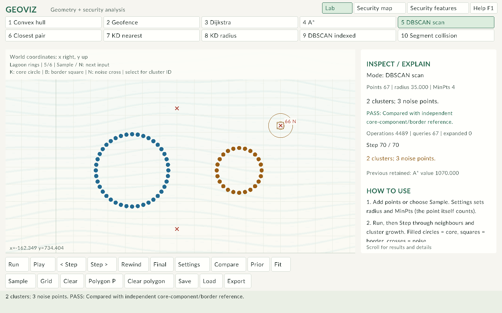
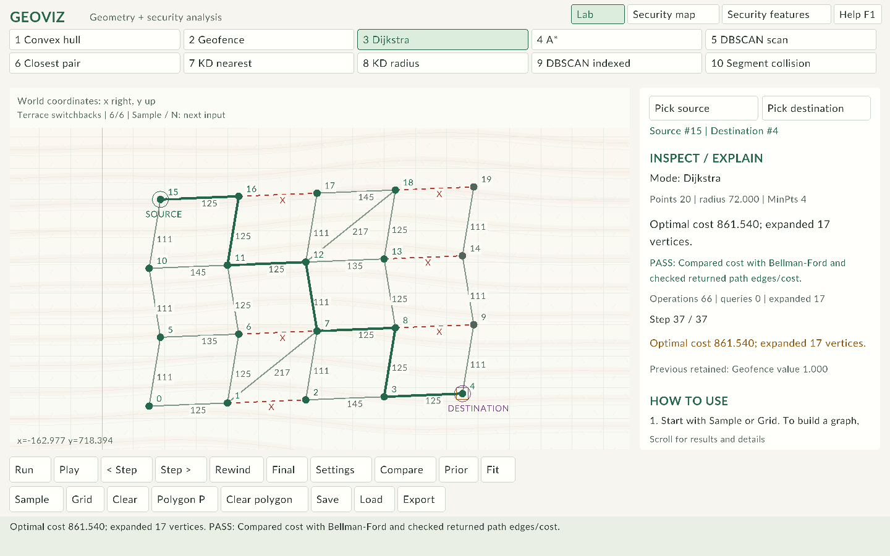

# Sample catalogue

The laboratory contains 60 deterministic, editable scenes, arranged as six inputs per algorithm. **Sample / N** cycles the selected mode. Import a scene, select its listed mode and run the calculation. Each checked report links to its corresponding input.

The [offline guide](index.html) includes checked algorithm and security recordings. Operation counts exclude verification and playback.

| Tidal and lagoon family | Terrace and mosaic family |
| --- | --- |
|  |  |

## 1. Compact reference

| Mode | Points | Radius / MinPts | Checked result | Input / report |
| --- | ---: | --- | --- | --- |
| Convex hull | 12 | 75 / 4 | Hull has 7 vertices. | [Scene](../data/sample_0.scene) · [Run](runs/sample_0.txt) |
| Geofence | 12 | 75 / 4 | INSIDE | [Scene](../data/sample_1.scene) · [Run](runs/sample_1.txt) |
| Dijkstra | 12 | 75 / 4 | Optimal cost 403.434; expanded 9 vertices. | [Scene](../data/sample_2.scene) · [Run](runs/sample_2.txt) |
| A* | 12 | 75 / 4 | Optimal cost 403.434; expanded 5 vertices. | [Scene](../data/sample_3.scene) · [Run](runs/sample_3.txt) |
| DBSCAN scan | 26 | 45 / 4 | 2 clusters; 2 noise points. | [Scene](../data/sample_4.scene) · [Run](runs/sample_4.txt) |
| Closest pair | 12 | 75 / 4 | Closest distance 82.462 | [Scene](../data/sample_5.scene) · [Run](runs/sample_5.txt) |
| KD nearest | 12 | 75 / 4 | Nearest distance 53.852 | [Scene](../data/sample_6.scene) · [Run](runs/sample_6.txt) |
| KD radius | 12 | 75 / 4 | 1 point inside radius. | [Scene](../data/sample_7.scene) · [Run](runs/sample_7.txt) |
| DBSCAN indexed | 26 | 45 / 4 | 2 clusters; 2 noise points. | [Scene](../data/sample_8.scene) · [Run](runs/sample_8.txt) |
| Segment collision | 8 | 75 / 4 | 2 intersecting segment pairs. | [Scene](../data/sample_9.scene) · [Run](runs/sample_9.txt) |

## 2. Coastal survey / campus deliveries / festival courtyards

| Mode | Points | Radius / MinPts | Checked result | Input / report |
| --- | ---: | --- | --- | --- |
| Convex hull | 36 | 82 / 4 | Hull has 10 vertices. | [Scene](../data/gallery/mode_0_1.scene) · [Run](runs/mode_0_1.txt) |
| Geofence | 36 | 82 / 4 | INSIDE | [Scene](../data/gallery/mode_1_1.scene) · [Run](runs/mode_1_1.txt) |
| Dijkstra | 24 | 82 / 4 | Optimal cost 982.884; expanded 24 vertices. | [Scene](../data/gallery/mode_2_1.scene) · [Run](runs/mode_2_1.txt) |
| A* | 24 | 82 / 4 | Optimal cost 982.884; expanded 21 vertices. | [Scene](../data/gallery/mode_3_1.scene) · [Run](runs/mode_3_1.txt) |
| DBSCAN scan | 52 | 43 / 4 | 3 clusters; 4 noise points. | [Scene](../data/gallery/mode_4_1.scene) · [Run](runs/mode_4_1.txt) |
| Closest pair | 38 | 82 / 4 | Closest distance 5.000 | [Scene](../data/gallery/mode_5_1.scene) · [Run](runs/mode_5_1.txt) |
| KD nearest | 36 | 82 / 4 | Nearest distance 42.944 | [Scene](../data/gallery/mode_6_1.scene) · [Run](runs/mode_6_1.txt) |
| KD radius | 36 | 82 / 4 | 6 points inside radius. | [Scene](../data/gallery/mode_7_1.scene) · [Run](runs/mode_7_1.txt) |
| DBSCAN indexed | 52 | 43 / 4 | 3 clusters; 4 noise points. | [Scene](../data/gallery/mode_8_1.scene) · [Run](runs/mode_8_1.txt) |
| Segment collision | 12 | 82 / 4 | 9 intersecting segment pairs. | [Scene](../data/gallery/mode_9_1.scene) · [Run](runs/mode_9_1.txt) |

## 3. Orbital sensors / warehouse aisles / curved swarms

| Mode | Points | Radius / MinPts | Checked result | Input / report |
| --- | ---: | --- | --- | --- |
| Convex hull | 36 | 82 / 4 | Hull has 8 vertices. | [Scene](../data/gallery/mode_0_2.scene) · [Run](runs/mode_0_2.txt) |
| Geofence | 36 | 82 / 4 | OUTSIDE | [Scene](../data/gallery/mode_1_2.scene) · [Run](runs/mode_1_2.txt) |
| Dijkstra | 24 | 82 / 4 | Optimal cost 966.200; expanded 22 vertices. | [Scene](../data/gallery/mode_2_2.scene) · [Run](runs/mode_2_2.txt) |
| A* | 24 | 82 / 4 | Optimal cost 966.200; expanded 16 vertices. | [Scene](../data/gallery/mode_3_2.scene) · [Run](runs/mode_3_2.txt) |
| DBSCAN scan | 48 | 35 / 3 | 2 clusters; 4 noise points. | [Scene](../data/gallery/mode_4_2.scene) · [Run](runs/mode_4_2.txt) |
| Closest pair | 38 | 82 / 4 | Closest distance 5.000 | [Scene](../data/gallery/mode_5_2.scene) · [Run](runs/mode_5_2.txt) |
| KD nearest | 36 | 82 / 4 | Nearest distance 34.381 | [Scene](../data/gallery/mode_6_2.scene) · [Run](runs/mode_6_2.txt) |
| KD radius | 36 | 82 / 4 | 6 points inside radius. | [Scene](../data/gallery/mode_7_2.scene) · [Run](runs/mode_7_2.txt) |
| DBSCAN indexed | 48 | 35 / 3 | 2 clusters; 4 noise points. | [Scene](../data/gallery/mode_8_2.scene) · [Run](runs/mode_8_2.txt) |
| Segment collision | 12 | 82 / 4 | 3 intersecting segment pairs. | [Scene](../data/gallery/mode_9_2.scene) · [Run](runs/mode_9_2.txt) |

## 4. Orchard inspection / valley detour / mixed-density survey

| Mode | Points | Radius / MinPts | Checked result | Input / report |
| --- | ---: | --- | --- | --- |
| Convex hull | 36 | 82 / 4 | Hull has 13 vertices. | [Scene](../data/gallery/mode_0_3.scene) · [Run](runs/mode_0_3.txt) |
| Geofence | 36 | 82 / 4 | INSIDE | [Scene](../data/gallery/mode_1_3.scene) · [Run](runs/mode_1_3.txt) |
| Dijkstra | 24 | 82 / 4 | Optimal cost 956.556; expanded 17 vertices. | [Scene](../data/gallery/mode_2_3.scene) · [Run](runs/mode_2_3.txt) |
| A* | 24 | 82 / 4 | Optimal cost 956.556; expanded 15 vertices. | [Scene](../data/gallery/mode_3_3.scene) · [Run](runs/mode_3_3.txt) |
| DBSCAN scan | 52 | 40 / 4 | 2 clusters; 22 noise points. | [Scene](../data/gallery/mode_4_3.scene) · [Run](runs/mode_4_3.txt) |
| Closest pair | 38 | 82 / 4 | Closest distance 5.000 | [Scene](../data/gallery/mode_5_3.scene) · [Run](runs/mode_5_3.txt) |
| KD nearest | 36 | 82 / 4 | Nearest distance 58.063 | [Scene](../data/gallery/mode_6_3.scene) · [Run](runs/mode_6_3.txt) |
| KD radius | 36 | 82 / 4 | 4 points inside radius. | [Scene](../data/gallery/mode_7_3.scene) · [Run](runs/mode_7_3.txt) |
| DBSCAN indexed | 52 | 40 / 4 | 2 clusters; 22 noise points. | [Scene](../data/gallery/mode_8_3.scene) · [Run](runs/mode_8_3.txt) |
| Segment collision | 16 | 82 / 4 | 28 intersecting segment pairs. | [Scene](../data/gallery/mode_9_3.scene) · [Run](runs/mode_9_3.txt) |

## 5. Tidal archipelago / lagoon survey / island bridges

| Mode | Points | Radius / MinPts | Checked result | Input / report |
| --- | ---: | --- | --- | --- |
| Convex hull | 48 | 72 / 4 | Hull has 11 vertices. | [Scene](../data/gallery/mode_0_4.scene) · [Run](runs/mode_0_4.txt) |
| Geofence | 48 | 72 / 4 | BOUNDARY | [Scene](../data/gallery/mode_1_4.scene) · [Run](runs/mode_1_4.txt) |
| Dijkstra | 18 | 72 / 4 | Optimal cost 1070.000; expanded 14 vertices. | [Scene](../data/gallery/mode_2_4.scene) · [Run](runs/mode_2_4.txt) |
| A* | 18 | 72 / 4 | Optimal cost 1070.000; expanded 14 vertices. | [Scene](../data/gallery/mode_3_4.scene) · [Run](runs/mode_3_4.txt) |
| DBSCAN scan | 67 | 35 / 4 | 2 clusters; 3 noise points. | [Scene](../data/gallery/mode_4_4.scene) · [Run](runs/mode_4_4.txt) |
| Closest pair | 50 | 72 / 4 | Closest distance 5.000 | [Scene](../data/gallery/mode_5_4.scene) · [Run](runs/mode_5_4.txt) |
| KD nearest | 41 | 72 / 4 | Nearest distance 72.000 | [Scene](../data/gallery/mode_6_4.scene) · [Run](runs/mode_6_4.txt) |
| KD radius | 41 | 72 / 4 | 4 points inside radius. | [Scene](../data/gallery/mode_7_4.scene) · [Run](runs/mode_7_4.txt) |
| DBSCAN indexed | 67 | 35 / 4 | 2 clusters; 3 noise points. | [Scene](../data/gallery/mode_8_4.scene) · [Run](runs/mode_8_4.txt) |
| Segment collision | 16 | 72 / 4 | 6 intersecting segment pairs. | [Scene](../data/gallery/mode_9_4.scene) · [Run](runs/mode_9_4.txt) |

## 6. Terraced botanical garden / planted corridors / mosaic survey

| Mode | Points | Radius / MinPts | Checked result | Input / report |
| --- | ---: | --- | --- | --- |
| Convex hull | 35 | 72 / 4 | Hull has 9 vertices. | [Scene](../data/gallery/mode_0_5.scene) · [Run](runs/mode_0_5.txt) |
| Geofence | 35 | 72 / 4 | INSIDE | [Scene](../data/gallery/mode_1_5.scene) · [Run](runs/mode_1_5.txt) |
| Dijkstra | 20 | 72 / 4 | Optimal cost 861.540; expanded 17 vertices. | [Scene](../data/gallery/mode_2_5.scene) · [Run](runs/mode_2_5.txt) |
| A* | 20 | 72 / 4 | Optimal cost 861.540; expanded 15 vertices. | [Scene](../data/gallery/mode_3_5.scene) · [Run](runs/mode_3_5.txt) |
| DBSCAN scan | 76 | 29 / 4 | 4 clusters; 4 noise points. | [Scene](../data/gallery/mode_4_5.scene) · [Run](runs/mode_4_5.txt) |
| Closest pair | 37 | 72 / 4 | Closest distance 5.000 | [Scene](../data/gallery/mode_5_5.scene) · [Run](runs/mode_5_5.txt) |
| KD nearest | 36 | 60 / 4 | Nearest distance 60.000 | [Scene](../data/gallery/mode_6_5.scene) · [Run](runs/mode_6_5.txt) |
| KD radius | 36 | 60 / 4 | 4 points inside radius. | [Scene](../data/gallery/mode_7_5.scene) · [Run](runs/mode_7_5.txt) |
| DBSCAN indexed | 76 | 29 / 4 | 4 clusters; 4 noise points. | [Scene](../data/gallery/mode_8_5.scene) · [Run](runs/mode_8_5.txt) |
| Segment collision | 16 | 72 / 4 | 14 intersecting segment pairs. | [Scene](../data/gallery/mode_9_5.scene) · [Run](runs/mode_9_5.txt) |

## Security datasets

In either security view, **Sample / N** cycles the catalogue. Each selection restores its documented radii, MinPts, fence and default window. Changing views preserves the current settings and reviews. All records are synthetic.

| Dataset | File / selected records | Devices | Scenario |
| --- | ---: | ---: | --- |
| [Compact reference](../data/security_sample.csv) | 12 / 12 | 12 | Normal use, approved backup and an isolated failure burst |
| [Campus operations](../data/security_campus.csv) | 50 / 48 | 16 | Repeated records, remote transfers and excluded time endpoints |
| [Research network](../data/security_research.csv) | 42 / 40 | 20 | Mixed device groups and observations with unknown labels |
| [Perimeter inspection](../data/security_perimeter.csv) | 16 / 16 | 16 | Corner, edge, interior and exterior observations |
| [Authentication bursts](../data/security_authentication.csv) | 36 / 36 | 12 | Clustered failures, an interior burst and an approved backup |
| [Device movement](../data/security_movement.csv) | 48 / 48 | 8 | Repeated device locations crossing the permitted boundary |
| [Low-activity telemetry](../data/security_quiet.csv) | 9 / 9 | 9 | Zero-count observations and unknown-label evaluation |
| [Time-window boundaries](../data/security_windows.csv) | 27 / 24 | 12 | Inclusive start, exclusive end and quoted identity filters |
| [Dense campus traffic](../data/security_crowd.csv) | 128 / 128 | 64 | Overlapping observations and several activity-density groups |

Use the source-linked inspector to review a device, then export evidence. [Security processing](SECURITY.md) explains the metric, filters, labels and review rule.

## Additional grid

**Grid** loads 70 vertices with unit-cost four-neighbour connections and a barrier opening. Source 0 to goal 69 has optimal cost **15** in both Dijkstra and A*. Block another passage to test detours or unreachable results.

## Deliberate edge cases

The tests also construct duplicates, collinear hulls, exact-radius queries, nearest ties, overlapping segments, zero-length segments, unreachable graphs and noise-to-border transitions. These cases are separate from the larger visual samples so their expected answers stay easy to inspect.
