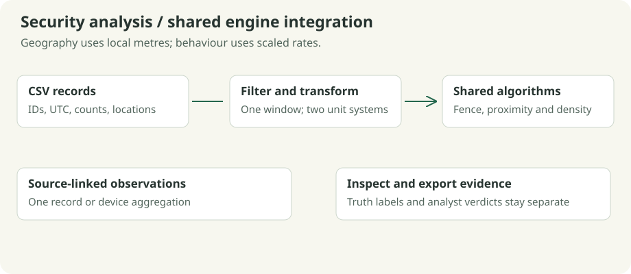

# Spatial security console

The console turns source events into geometric observations, then reuses the lab's existing algorithms. Two views answer different questions and retain different units.



## Geographic view

Each selected source event becomes one point. Latitude/longitude are projected to local east/north metres around the configured origin:

```text
x = R × (longitude - origin longitude) × pi/180 × cos(origin latitude × pi/180)
y = R × (latitude  - origin latitude)  × pi/180
R = 6,371,000 metres
```

The default origin is 20.2961° N, 85.8245° E. The local model supports a 50 km extent about the origin and origin latitude within ±80°. It is an approximate small-area projection. The offline campus CSV is an illustrative geographic layer with roads, buildings and open areas, rather than a surveyed campus map.

The permitted polygon is separate from the map boundary. Geofence queries classify inside, boundary or outside. Boundary is permitted. Diamonds mark observations strictly outside the polygon. K-d nearest/radius queries inspect proximity in metres; DBSCAN groups nearby observations using the geographic radius.

## Behavioural view

First apply the same time/user/device filters, then aggregate selected records by device. Every device uses the full selected window duration:

```text
minutes = (end - start) / 60
request rate = sum(requests) / minutes
failure rate = sum(failures) / minutes
x = request rate / request scale
y = failure rate / failure scale
```

Default scales are 10 requests/min and 1 failure/min; feature radius is 0.8 and MinPts is 3, including self. For example, 400 requests and 40 failures over ten minutes produce `(4, 4)` after scaling. A behavioural radius is a distance in this scaled plane, not metres or failure percentage.

`Observation::events()` preserves contributing source indices. A geographic point links to one record; a feature point may link to several. Selecting either view shows identities, neighbours, timestamps, raw counts, summaries and analyst verdicts in the inspector. Sample truth labels are used only for evaluation.

## Investigate and reproduce

1. Choose **Security map** and press Sample to cycle through nine scenarios.
2. Run indexed DBSCAN, inspect groups/outside observations and select a point.
3. Open Settings to adjust the common `[start, end)` window, exact user/device filters (`*` means all), radii, MinPts or scales.
4. Switch to **Security features**, run again, and inspect the device's raw rates and source records.
5. Choose **Benign** or **Suspect** to record analyst judgement for the selected observation's contributing records.
6. Export. The output contains source events, filters, projection/scales, parameters, query locations, labels, checks, review counts, both view scenes and a complete `.security` snapshot.

Reloading the snapshot reproduces the analysis independently of the current CSV. New CSV imports clear source-linked reviews. Sample changes reset the analysis context; ordinary view switching keeps settings and review state.

CSV imports retain the active window, filters and fence. Select a scenario with **Sample / N** to restore its preset configuration.

## CSV schema and samples

```csv
event_id,timestamp,user_id,device_id,latitude,longitude,requests,failures,label,summary
example-01,1800000100,user-01,device-01,20.2961,85.8245,400,40,benign,Approved research transfer
```

IDs must be nonempty and event IDs unique. Counts are nonnegative integers with failures ≤ requests; request counts are bounded at one billion. Labels are `benign`, `suspicious`, or `unknown`. The parser supports quoted commas and doubled quotes, with single-line records and an exact header. Inputs are limited to 8 MiB, 4,096 source records and 256 displayed observations; narrow filters when necessary.

The [sample catalogue](SAMPLES.md#security-datasets) lists all nine datasets and their record counts. `data/security_samples.csv` is the common registry used by the application and documentation.

| Scenario | Investigation procedure | Expected behaviour |
| --- | --- | --- |
| Perimeter inspection | Run Geofence in the map; inspect corners, edge points and observations 0.5 m from the fence | The preset query is a boundary vertex. Boundary observations are permitted; exterior observations are marked for review. |
| Authentication bursts | Compare the map and feature clusters; inspect the interior burst and approved backup | A coherent failure burst may form a cluster. Density alone does not identify malicious activity. |
| Device movement | Filter a device and inspect its chronologically linked source records | Repeated locations retain distinct event identities and aggregate into one behavioural observation per device. |
| Low-activity telemetry | Run clustering and inspect the evaluation output | Zero-count observations remain valid. Unknown labels are excluded from confusion-matrix denominators. |
| Time-window boundaries | Filter user `lab, "night"`; compare the full window with a start of `1800000300` | Start timestamps are included and end timestamps excluded. Rates use the complete selected window duration. |
| Dense campus traffic | Compare direct and indexed DBSCAN on the same filtered input | Both implementations produce identical labels and core/border/noise classifications despite overlapping observations. |

The original reference, campus and research datasets remain available. Sample selection restores preset parameters and clears source-linked reviews; changing views preserves the active analysis.

## Review evaluation

The documented candidate rule is **feature DBSCAN noise OR strictly outside the permitted polygon**. It is evaluated per selected source event. A device noise flag propagates to that device's selected records. Known labels produce TP/FP/TN/FN counts; unknown labels are reported separately. Precision, recall and false-positive rate are `N/A` when their denominator is zero. Analyst review is counted separately and never overwrites sample truth.

The compact reference produces **TP=1, FP=1, TN=10, FN=0** with the default parameters and supplied rectangular fence. The false positive is an approved backup outlier. This illustrates why geographic outliers and density noise require contextual review. These synthetic counts do not establish production accuracy.

The adapter reads explicitly selected local exports. The application is an educational analysis console; it does not provide authentication, secure storage, live account ingestion or automated incident response.

## Version 2 evidence schema and sensitivity

`GEOVIZ_SECURITY 2` adds quoted analyst notes and integer UTC review times after each verdict.
Version 1 snapshots still load. New settings/event/fence replacements validate a candidate first;
CSV ingestion validates schema independently of the projection origin. Out-of-region event data
is rejected against the configured origin. An unavailable/out-of-region campus background leaves
an empty background without rejecting valid events.

Evidence JSON uses `geoviz.evidence.v1` and contains app/source revision, declared units, parameters,
a canonical source-record `fnv1a64` consistency hash, reference-check status, source identities,
cluster/noise data and event-level `feature_noise`, `outside_region`, and `candidate` flags. The rule
is always feature noise OR outside region; geographic noise is separately displayed. JSON retains
review note/time and sample truth in separate fields. The adjacent `.security` file retains all
source data and the fence needed to reproduce the result. The JSON is an index into that snapshot,
not a replacement for it. Unsigned hashes do not authenticate an investigator or an export.

F8 opens a sensitivity panel comparing radius factors 0.75/1/1.25 and MinPts +/-1, plus measurement
scale factors 0.75/1.25. Exports retain the same comparison. Changed noise status helps explain
parameter sensitivity and is not a production detection-accuracy estimate.
