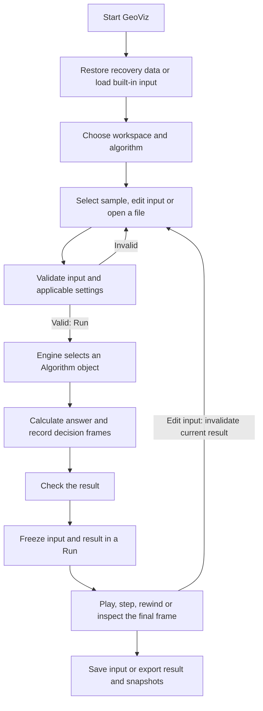
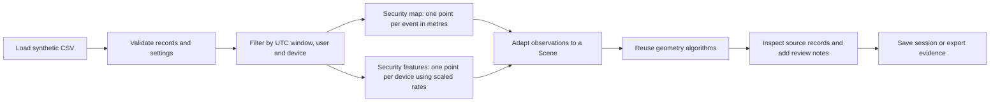

# Project workflow

## Main workflow

1. **Input:** `App` starts with a built-in Lab scene and the first security dataset.
   A valid recovery snapshot restores previous work when present. The user chooses a
   workspace, algorithm and sample, or opens a supported local file.
2. **Validation:** `Scene` guards edits; `SettingsPanel` prepares detached changes.
   `Engine::validate` checks common execution input. Polygon algorithms validate
   completed fences; invalid drafts remain editable.
3. **Execution:** `Engine::execute` selects a concrete `Algorithm`.
   The inherited `Algorithm::run` performs validation, calculation and result checking.
   Calculation records explanations, pseudocode line IDs and relevant intermediate state.
4. **Inspection:** `Run` owns a frozen scene/result pair. `Playback` changes the frame
   cursor; drawing reads that frame. Editing invalidates the current result, so the user
   runs the algorithm again.
5. **Output:** Save stores editable input. Export stores a Lab summary with its scene,
   or security evidence with source-linked observations and snapshots. Undo/redo and
   recovery retain input history independently of completed runs.

## Security workflow

The UTC window includes its start and excludes its end. Geographic observations use a
local projection around the configured origin. Feature observations aggregate requests
and failures over the entire selected time window, then divide rates by their scales.

A review candidate is an event outside the permitted fence or an event belonging to
a device classified as feature-space DBSCAN noise. Candidates are investigation aids.
Synthetic truth labels support evaluation and never serve as clustering features;
analyst verdicts and notes are stored separately.

## Shared execution paths

- Dijkstra and A* share route search; only the heuristic changes.
- Both DBSCAN modes share cluster expansion; the neighbourhood strategy changes.
- KD nearest and radius queries share tree traversal and pruning.
- Security map and feature views publish validated derived data through one method.
- Recovery and recovery-history saves share the same snapshot-writing method.
